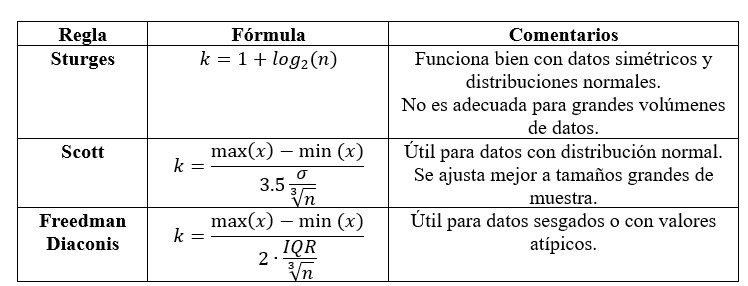
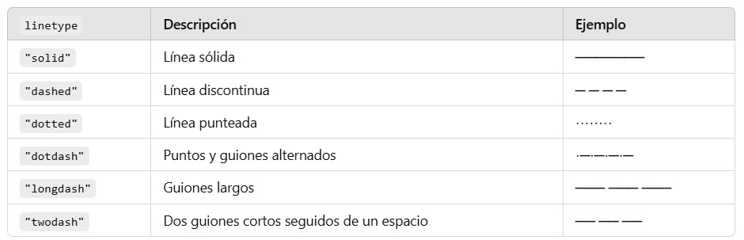
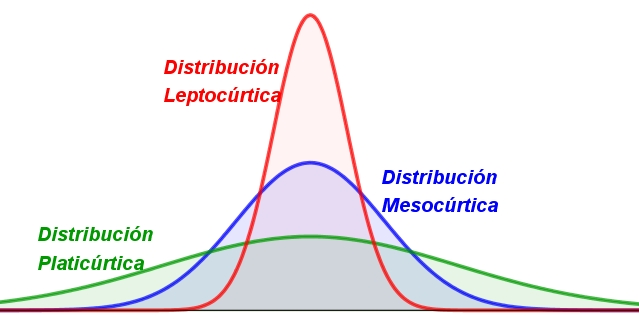
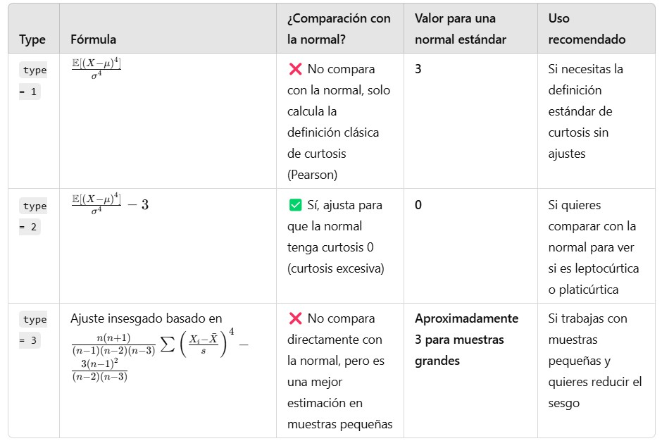
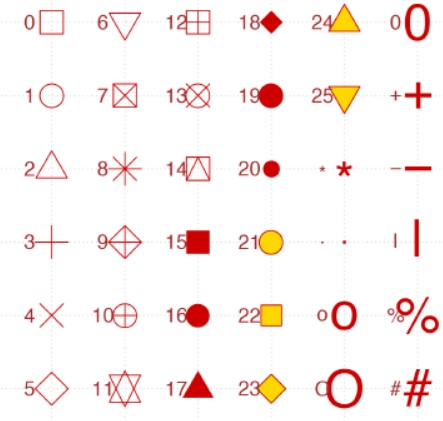

Cargamos librerías
```{r, message=FALSE, warning=FALSE}
library(readxl)
library(dplyr)
library(ggplot2)
library(patchwork) # Visualizar gráficos acomodándolos por filas y columnas 
library(moments) # Para calcular la asimetría
library(e1071) # Calcular la curtosis
```

Importamos la base de datos
```{r}
df_asegurados <- read_excel("expenses.xlsx")
View(df_asegurados)
```

Realizamos un histograma de frecuencias para cada variable numérica
```{r}
hist(x = df_asegurados$age,
     col = "skyblue",
     border = "pink3", # Color a los bordes
     main = "Histograma de Frecuencias Edad Asegurados",
     xlab = "Edad",
     ylab = "Frecuencia",
     labels = TRUE,
     ylim = c(0,190))

hist(x = df_asegurados$bmi,
     col = "skyblue",
     border = "darkblue", # Color a los bordes
     main = "Histograma de Frecuencias IMC Asegurados",
     xlab = "IMC",
     ylab = "Frecuencia",
     labels = TRUE,
     ylim = c(0,450))

hist(x = df_asegurados$charges,
     col = "skyblue",
     border = "darkblue", # Color a los bordes
     main = "Histograma de Frecuencias Cargos Asegurados",
     xlab = "Cargos",
     ylab = "Frecuencia",
     labels = TRUE,
     ylim = c(0,400))
```

Forma alternativa utilziando la librería ggplot2


```{r}
k_sturges <- nclass.Sturges(df_asegurados$age)
k_scott <- nclass.scott(df_asegurados$age)
k_freedman <- nclass.FD(df_asegurados$age)

g1 <- ggplot(data = df_asegurados, mapping = aes(x = age)) +
  geom_histogram(fill = "skyblue", color = "darkblue", bins = k_scott) +
  labs(title = "Frecuencia Edad Asegurados", x = "Edad", y = "Frecuencia") +
  theme_dark()

k_bmi <- nclass.scott(df_asegurados$bmi)
g2 <- ggplot(data = df_asegurados, mapping = aes(x = bmi)) +
  geom_histogram(fill = "skyblue", color = "darkblue", bins = k_bmi) +
  labs(title = "Frecuencia IMC Asegurados", x = "IMC", y = "Frecuencia") +
  theme_classic()

k_cargos <- nclass.FD(df_asegurados$charges)
g3 <- ggplot(data = df_asegurados, mapping = aes(x = charges)) +
  geom_histogram(fill = "skyblue", color = "darkblue", bins = k_cargos) +
  labs(title = "Frecuencia Cargos Asegurados", x = "Cargos", y = "Frecuencia") +
  theme_light()

(g1 | g2) / g3
```

# Asimetría

La **asimetría** (o sesgo) es una medida que indica qué tan simétrica es la distribución de los datos con respecto a su media.

Formalmente, decimos que una distribución de frecuencias es simétrica si la media $\bar{x}$ es igual a la mediana $\bar{M_e}$. Esto significa que, en cualquier otro caso, la distribución es asimétrica.

Cuando $\bar{M_e} < \bar{x}$ decimos que la distribución es Asimétrica a la derecha, Asimétrica de cola derecha o que tiene Asimetría positiva.

Cuando $\bar{M_e} > \bar{x}$ decimos que la distribución es Asimétrica a la izquierda, Asimétrica de cola izquierda o que tiene Asimetría Negativa.

Para los tipos de línea, utilizar la siguiente referencia:

Trabajemos con una distribución normal para ejemplificar la asimetría de una distribución.
```{r}
# Generamos datos aleatorios que siguen una distribución normal
set.seed(123)
datos_normales <- round(rnorm(n = 1000, mean = 20000, sd = 2000), 2)
media_salarios <- mean(datos_normales)
mediana_salarios <- median(datos_normales)
df_salarios <- data.frame(Salarios = datos_normales)
# Graficamos el histograma de frecuencias
k_salarios <- nclass.scott(df_salarios$Salarios)
ggplot(df_salarios, aes(x = Salarios)) +
  geom_histogram(fill = "skyblue", color = "black", bins = k_salarios, alpha = 0.5) +
  geom_vline(aes(xintercept = media_salarios), color = "red", linetype = "dashed", size = 1) + 
  geom_vline(aes(xintercept = mediana_salarios), color = "blue", linetype = "dotted", size = 1) +
  labs(title = "Histograma de Datos Normales", x = "Valores", y = "Frecuencia") +
  theme_minimal()
# Conclusión: A través de la visualización podemos notar que la distribución de los datos es simétrica respecto a su media.
```

Trabajamos con una distribución Exponencial para ejemplificar la asimetría a la derecha.
```{r}
# Generamos datos aleatorios que siguen una distribución exponencial
set.seed(123)
datos_expo <- round(rexp(n = 1000, rate = 1/10))
media_tiempos <- mean(datos_expo)
mediana_tiempos <- median(datos_expo)
df_tiempos <- data.frame(Tiempos = datos_expo)

# Graficamos el histograma de frecuencias
k_tiempos <- nclass.FD(df_tiempos$Tiempos)
ggplot(df_tiempos, aes(x = Tiempos)) +
  geom_histogram(fill = "skyblue", color = "black", bins = k_tiempos, alpha = 0.5) +
  geom_vline(aes(xintercept = media_tiempos), color = "red", linetype = "dashed", size = 1) + 
  geom_vline(aes(xintercept = mediana_tiempos), color = "blue", linetype = "dotted", size = 1) +
  labs(title = "Histograma de Datos Exponenciales", x = "Valores", y = "Frecuencia") +
  theme_minimal()
# Conclusión: A través de la visualización podemos notar que la distribución de los datos es asimétrica a la derecha. 
```

Trabajamos con una distribución Weibull con ciertos parámetros para ejemplificar la asimétrica a la izquierda
```{r}
# Generamos datos aleatorios que siguen una distribución Weibull
set.seed(123)
datos_weibull <- round(rweibull(n = 1000, shape = 5, scale = 2),2)
media_weibull <- mean(datos_weibull)
mediana_weibull <- median(datos_weibull)
df_weibull <- data.frame(Valores = datos_weibull)

# Graficamos el histograma de frecuencias
k_weibull <- nclass.scott(df_weibull$Valores)
ggplot(df_weibull, aes(x = Valores)) +
  geom_histogram(fill = "skyblue", color = "black", bins = k_weibull, alpha = 0.5) +
  geom_vline(aes(xintercept = media_weibull), color = "red", linetype = "dashed", size = 1) + 
  geom_vline(aes(xintercept = mediana_weibull), color = "blue", linetype = "dotted", size = 1) +
  annotate("text", x = media_weibull - 0.1, y = 50, label = "Media", angle = 90, size = 5, color = "red") +
  annotate("text", x = mediana_weibull + 0.1, y = 50, label = "Mediana", angle = 270, size = 5, color = "blue") +
  labs(title = "Histograma de Datos Weibull", x = "Valores", y = "Frecuencia") +
  theme_minimal()
# Conclusión: A través de la visualización podemos notar que la distribución de los datos es asimétrica a la izquierda. 
```

Verificamos la Asimetría de las variables numéricas de nuestra base de datos de los Asegurados.
```{r}
# Tarea, Realizar los gráficos (histogramas) para las arreglos de age, bmi, charges. 
# Verificar gráficamente su asimetría y concluir si es simétrica, o asimétrica a la derecha p asimétrica a la izquierda.
```

El **coeficiente de asimetría** también conocido como el coeficiente de asimetría de Fisher-Pearson, se basa en el tercer momento central:

$$
\mu_3 = E[(X-\mu)^3]
$$
Se utiliza $\sigma^3$ para obtener la asimetría estandarizada.

$$
\frac{\mathbb{E}[(X - \mu)^3]}{\sigma^3} = \mathbb{E} \left[ \left( \frac{X - \mu}{\sigma} \right)^3 \right] = \frac{\mu_3}{\sigma^3}
$$

  1. Si $asimetría = 0$ entonces la distribución es simétrica.
  2. Si $asimetría > 0$ entonces la distribución es asimétrica a la derecha.
  3. Si $asimetría < 0$ entonces la distribución es asimétrica a la izquierda.
  
```{r}
cf_asimetria_edad <- skewness(df_asegurados$age) # Aproximadamente es simétrica.
cf_asimetria_bmi <- skewness(df_asegurados$bmi) # Asimétrica a la derecha.
cf_asimetria_cargos <- skewness(df_asegurados$charges) # Asimétrica a la derecha. 
cf_asimetria_edad; cf_asimetria_bmi; cf_asimetria_cargos
```

# Curtosis

La **curtosis** es una medida estadística que se utiliza para evaluar la forma de la distribución de un conjunto de datos y, específicamente, para medir cuán “afilada” o “achatada” es la distribución en comparación con una distribución normal. Indica la concentración de valores alrededor de la media y la presencia de valores extremos en la distribución de datos.



**Distribución leptocúrtica:** El coeficiente de curtosis es positivo para una distribución leptocúrtica. Presenta un elevado grado de concentración alrededor de los valores centrales de la variable.Las colas de la distribución son más pesadas, lo que significa que los valores extremos son más probables.

**Distribución mesocúrtica:** Presenta un grado de concentración medio alrededor de los valores centrales de la variable (el mismo que presenta una distribución normal). Los valores extremos o atípicos son menos comunes en este tipo de distribución.La curtosis se aproxima a cero para una distribución mesocúrtica.

**Distribución platicúrtica:** Presenta un reducido grado de concentración alrededor de los valores centrales de la variable y sus valores están más dispersos. Tienen una forma achatada con un pico más bajo en el centro y colas menos pronunciadas. El coeficiente de curtosis es negativo para una distribución platicúrtica.

El cuarto momento central se usa para medir la curtosis, que refleja si las colas de una distribución son más pesadas o ligeras que una distribución normal.

$$
\mu_4 = E[(X-\mu)^4]
$$
Se utiliza $\sigma^4$ para obtener la curtosis estandarizada.

$$
\frac{\mathbb{E}[(X - \mu)^4]}{\sigma^4} = \mathbb{E} \left[ \left( \frac{X - \mu}{\sigma} \right)^4 \right] = \frac{\mu_4}{\sigma^4}
$$


```{r}
kurtosis(df_asegurados$age, type = 2) # Forma Platicúrtica "Forma achatada"
kurtosis(df_asegurados$bmi, type = 2) # Forma Mesocúrtica "Aprox igual que la forma de la normal"
kurtosis(df_asegurados$charges, type = 2) # Forma Leptocúrtica "Forma afilada"
```


#Curvas de densidad 

La curva de densidad es una estimación suave de la distribución de probabilidad de un conjunto de datos continuos. A diferencia de un histograma, que agrupa los datos en intervalos y cuenta la frecuencia de ocurrencia dentro de cada intervalo, la curva de densidad proporciona una representación continua de cómo se distribuyen los datos a lo largo de su rango.

La estimación suave se refiere a una técnica utilizada en estadística para crear una representación continua y sin saltos de la distribución de datos, especialmente cuando esos datos están agrupados en intervalos o contienen ruido (variaciones aleatorias).

```{r}
k_scott <- nclass.scott(df_asegurados$age)
# ¿Uniforme?
a_hat <- min(df_asegurados$age)
b_hat <- max(df_asegurados$age)

g1 <- ggplot(data = df_asegurados, mapping = aes(x = age)) +
  geom_histogram(aes(y = after_stat(density)), fill = "skyblue", color = "darkblue", bins = k_scott) +
  geom_density(color = "red", linewidth = 1.5) +
  stat_function(fun = dunif, args = list(min = a_hat, max = b_hat), color = "green4", linewidth = 1.5) +
  labs(title = "Frecuencia Edad Asegurados", x = "Edad", y = "Frecuencia") +
  theme_dark()

#¿Normal?
k_bmi <- nclass.scott(df_asegurados$bmi)
library(fitdistrplus)
ajuste_normal <- fitdist(df_asegurados$bmi, "norm", method = "mle")
summary(ajuste_normal)

g2 <- ggplot(data = df_asegurados, mapping = aes(x = bmi)) +
  geom_histogram(aes(y = after_stat(density)), fill = "skyblue", color = "darkblue", bins = k_bmi) +
  geom_density(color = "red", linewidth = 1.5) +
  stat_function(fun = dnorm, args = list(mean = 30.663397, sd = 6.095908), color = "green4", linewidth = 1.5) +
  labs(title = "Frecuencia IMC Asegurados", x = "IMC", y = "Frecuencia") +
  theme_classic()

#¿Exponencial? ¿Weibull?
ajuste_expo <- fitdist(df_asegurados$charges, "exp", method = "mle")
summary(ajuste_expo)
ajuste_weibull <- fitdist(df_asegurados$charges, "weibull", method = "mle")
summary(ajuste_weibull)

k_cargos <- nclass.FD(df_asegurados$charges)
g3 <- ggplot(data = df_asegurados, mapping = aes(x = charges)) +
  geom_histogram(aes(y = after_stat(density)), fill = "skyblue", color = "darkblue", bins = k_cargos) +
  geom_density(color = "red", linewidth = 1.5) +
  stat_function(fun = dexp, args = list(rate = 7.535555e-05), color = "green4", linewidth = 1.5) +
  stat_function(fun = dweibull, args = list(shape = 1.175706, scale = 14103.795524), color = "purple3", linewidth = 1.5) +
  labs(title = "Frecuencia Cargos Asegurados", x = "Cargos", y = "Frecuencia") +
  theme_light()

(g1 | g2) / g3
```

## Cuartiles

Existen además de la media, mediana y moda otras **medidas de posición**, estas consisten en determinar la ubicación de los valores que dividen un conjunto de observaciones en partes iguales. 

Los cuartiles dividen a un conjunto de observaciones en cuatro partes iguales de en un conjunto de valores ordenados de menor a mayor.

El primer cuartil, que se representa mediante Q1, es el valor bajo el cual se presenta el 25% de las observaciones, y el tercer cuartil, simbolizado por Q3, es el valor bajo el cual se presenta el 75% de las observaciones. El segundo cuartil Q2 es igual al valor que se representa el 50% es decir igua a la mediana.

## Diagrama de Caja y Bigotes

El diagrama de caja es una representación gráfica basada en cuartiles que ayuda a presentar un conjunto de datos. Para construir un diagrama de caja solo se necesitan estos estadísticos: valor mínimo, Q1 (primer cuartil), mediana o Q2 (segundo cuartil), Q3 (tercer cuartil) y valor máximo.


Existe otro significado del diagrama, se pueden ver cuales son valores atípicos, extraños, muy altos o muy bajos, o outliers. Un dato atípico se trata de un valor que no concuerda con el resto de los datos.

Calculamos los cuartiles de la edad de los asegurados:

```{r}
cuartiles_edad <- quantile(x = df_asegurados$age, probs = c(0.25, 0.50, 0.75))
cuartiles_edad
# El 25% de los asegurados tiene una edad igual o menor a 27 años.
# El 50% de los asegurados tiene una edad iguil o menor a 39 años.
# El 75% de los asegurados tiene una edad igual o menor a 51 años.

cuartiles_IMC <- quantile(x = df_asegurados$bmi, probs = c(0.25, 0.50, 0.75))
cuartiles_IMC 
# El 25% de los asegurados tiene un IMC menor o igual a 26.29 puntos de IMC
# El 50% de los asegurados tienen un IMC mayor o igual a 30.40 puntos de IMC (Tenemos la mitad de la población en grado de obesidad tipo 1 y tipo 2)
# El 25% de los asegurados tienen un IMC mayor o igual a 34.69 puntos de IMC (Los casos graves de obesidad)

# Tarea: Calcular los cuartiles y dar una interpretación de estos para la variable Cargos por concepto de prima.
```

Realizamos el diagrama de caja y bigotes de la edad de los asegurados:

```{r}
boxplot(df_asegurados$age,
        col = "blue",
        main = "Diagrama Caja y Bigotes Edad Asegurados",
        xlab = "Asegurados",
        ylab = "Edad")
```

```{r}
ggplot(df_asegurados, aes(y = age)) +
  geom_boxplot(fill = "skyblue", color = "red") +
  stat_boxplot(geom = "errorbar", width = 0.5)
```


Calculamos los cuartiles de la edad de los asegurados por sexo.
```{r}
cuartiles_edad
ggplot(df_asegurados, aes(y = age)) +
  geom_boxplot(fill = "skyblue", color = "red") +
  stat_boxplot(geom = "errorbar", width = 0.5) + 
  annotate(geom = "text", x = -0.10, y = cuartiles_edad, label = cuartiles_edad)
```

Realizamos un diagrama de cajas y bigotes de la edad de los asegurados por sexo

```{r}

```

```{r}

```

# Diagramas de Dispersión

Los diagramas de dispersión se usan para mostrar la relación entre dos variables continuas (aunque también se suele representar como la relación de una variable continua y una categórica), cada observación se representa como un punto representado en coordenadas cartesianas.

Importamos la base de datos
```{r}

```

```{r}

```

Podemos modificar la forma de los puntos.

```{r}

```

Podemos agrupar los puntos utilizando alguna variable categórica
```{r}

```

```{r}

```

Podemos añadir información como por ejemplo, títulos en los ejes:
```{r}

```

Podemos agregar la linea de regresión lineal.

```{r}

```
