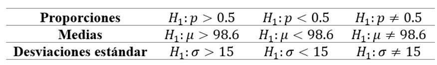
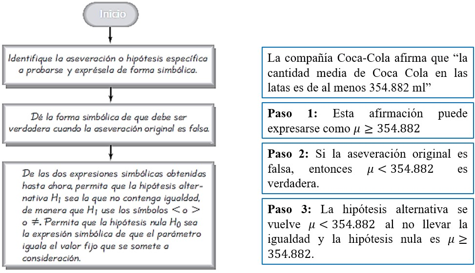
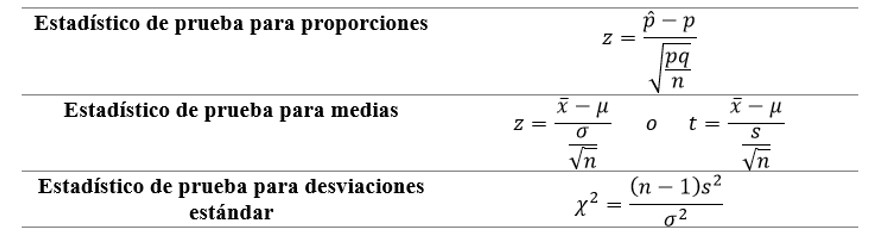
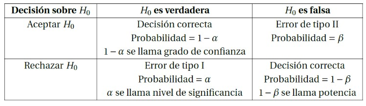
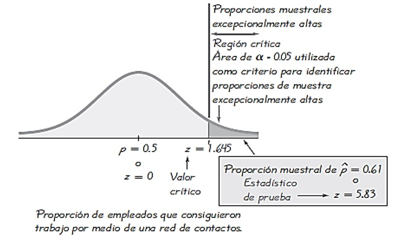
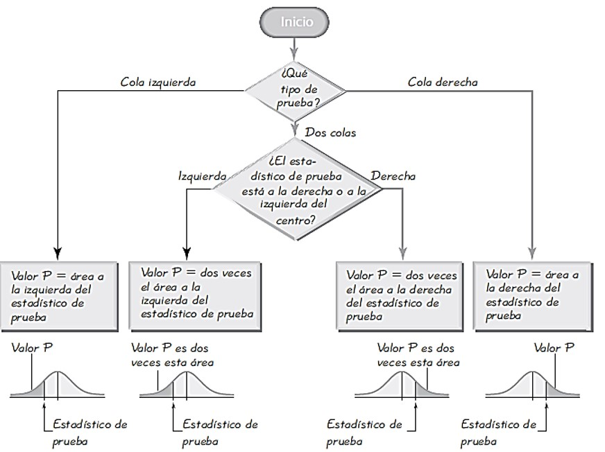
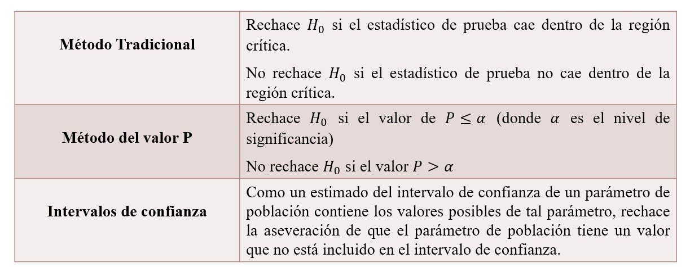

# Hipótesis Estadísticas

En estadística una **hipótesis** es una aseveración o afirmación acerca de una propiedad de una población.

Una **prueba de hipótesis** es un procedimiento estándar para probar una aseveración acerca de una propiedad de una población. 

La hipótesis nula (denotada por $𝐻_0$) es la afirmación de que el valor de un parámetro de la población (como una proporción, una media o una desviación estándar) es **igual** a un valor aseverado. 

Por ejemplo, las siguientes son hipótesis nulas:


*Nota*: Algunos libros de texto utilizan los símbolos ≤ y ≥ en la hipótesis nula, pero la mayoría de las revistas científicas sólo emplean el símbolo de igual para expresar igualdad. 

La **hipótesis alternativa** (Denotada por $𝐻_1, 𝐻_𝑎, 𝐻_𝐴$) es la afirmación de que el parámetro tiene un valor que, de alguna manera, **difiere** de la hipótesis nula.

 


**¿Cómo identificar a H_0 y H_1?**

 

**Actividad 1**

Utilice aseveraciones para expresar la hipótesis nula y alternativa en cada uno de los siguientes casos.

Caso 1: La proporción de empleados que consiguen trabajo por medio de una red de contactos es mayor que 0.5.

$$

$$

Caso 2: El peso medio de los pasajeros de un avión, con su equipaje de mano, es a lo sumo de 88.45 kilos.

$$

$$

Caso 3: La desviación estándar de las puntuaciones del coeficiente intelectual CI de los actores es igual a 15.

$$

$$

**Actividad 2** (Individual)

Utilice aseveraciones para expresar la hipótesis nula y alternativa en cada uno de los siguientes casos.

Caso 1: Más del 25% de los usuarios en Internet pagan facturas en línea.

$$

$$

Caso 2: Los dulces M&M tienen un peso medio de al menos 0.8535 gramos.

$$

$$

Caso 3: Las puntuaciones de CI de profesores universitarios tienen una desviación estándar menor que 15.

$$

$$

# Estadísticos de Prueba

Un **estadístico de prueba** es un valor que se utiliza para tomar la decisión sobre la hipótesis nula, y se calcula convirtiendo al estadístico muestral (como la proporción muestral $\hat{p}$, la media muestral $\bar{x}$, o la desviación estándar muestral $s$) en una puntuación (como $z, t,𝜒^2$), bajo el supuesto de que la hipótesis nula es verdadera. 



**Actividad 3**

Una encuesta de 703 empleados seleccionados al azar, reveló que el 61% de ellos consiguió trabajo por medio de una red de contactos. Calcule el valor del estadístico de prueba para la aseveración de que la mayoría de los empleados consiguen trabajo por medio de una red de contactos. 

Planteamos nuestro juego de hipótesis:
$$
H_0: p = 0.50 \\
H_1: p > 0.50
$$
Calculamos el estadístico de prueba para proporciones:
```{r}
estadistico_proporciones <- function(p_muestral, p_poblacional, n){
  z <- round((p_muestral - p_poblacional) / sqrt(p_poblacional * (1 - p_poblacional) / n),2)
  print(z)
}
estadistico_proporciones(0.61, 0.50, 703)
```

**Actividad 4**

Utiice aseveraciones para expresar la hipótesis nula y alternativa en cada uno de los siguientes casos. Luego, calcula el valor del estadístico de prueba.

Caso 1: La aseveración es que la proporción de adultos que fumaron un cigarrillo la semana pasada es menor que 0.25, y los estadísticos de muestra incluyen 𝑛=1018 sujetos, de los cuales 224 dicen que fumaron un cigarrillo la semana pasada. 

$$
H_0: p =  0.25 \\
H_1: p < 0.25
$$

```{r}
estadistico_proporciones(224/1018, 0.25, 1018)
```

La mayoría de las demandas por negligencia se retiran o se rechazan, y una muestra aleatoria de 500 demandas incluye 349 que fueron retiradas o rechazadas.

$$
H_0: p = 0.50 \\
H_1: p > 0.50
$$

```{r}
estadistico_proporciones(349/500, 0.50, 500)
```

## Región Crítica, Nivel de Significancia, Valor Crítico y P - Value

La **región crítica** (o región de rechazo) es el conjunto de todos los valores del estadístico de prueba que pueden provocar que rechacemos la hipótesis nula.

El **nivel de significancia** (denotado por 𝛼) es la probabilidad de que el estadístico de prueba caiga en la región crítica, cuando la hipótesis nula es verdadera. Si el estadístico de prueba cae en la región crítica, rechazamos la hipótesis nula, de manera que 𝛼 es la probabilidad de cometer el error de rechazar la hipótesis nula cuando es verdadera. 



**Ejemplo 1:** Un determinado fármaco experimental afirma tener una tasa de curación de al menos el 75% para los hombres con cáncer de próstata. Describa los errores tipo I y tipo II en este contexto. ¿Cuál es el error más grave?

$$
H_0 : p \geq 0.75 \\
H_1: p < 0.75
$$
Error Tipo I: Un paciente con cáncer cree que la tasa de curación del fármaco es inferior al 75%, cuando en realidad es de al menos el 75%.

Error Tipo II: Un paciente con cáncer de próstata cree que el fármaco experimental tiene un índice de curación de al menos el 75% cuando es inferior al 75%.

En este escenario, el error Tipo II es la consecuencia más grave. Si un paciente cree que el fármaco funciona, al menos en un 75% de las veces, lo más probable es que esto influya en la elección del paciente (y el médico) sobre la conveniencia de utilizar el fármaco como opción de tratamiento.

Un **valor crítico** es cualquier valor que separa a la región crítica (donde rechazamos la hipótesis nula) de los valores del estadístico de prueba que no conducen al rechazo de la hipótesis nula. 



**Actividad 5**

Con un nivel de significancia de $\alpha=0.05$, calcule los valores $z$ críticos para cada una de las siguientes hipótesis alternativas.

Caso 1: $p \neq 0.5$ (de manera que la región crítica está en ambas colas de la distribución normal)

```{r}
alpha1 <- 0.05
v_critico1_izq <- round(qnorm(alpha1/2, lower.tail = T),3)
v_critico1_der <- round(qnorm(1 - alpha1/2, lower.tail = T),3)
v_critico1_izq; v_critico1_der

# Función de la densidad normal estándar
curve(dnorm(x), from = -3.5, to = 3.5, col = "blue", lwd = 2, xlab = "Valores de Z", ylab = "Densidad", main = "Distribución Normal Estándar")

# Agregamos una linea vertical en los valores críticos.
abline(v = v_critico1_izq, col = "red", lwd = 2, lty = 2)
abline(v = v_critico1_der, col = "red", lwd = 2, lty = 2)

# Rellenar el área a la izquierda del valor crítico
x_sombreado <- seq(-3.5, v_critico1_izq, length.out = 100)
y_sombreado <- dnorm(x_sombreado)
polygon(c(-3.5, x_sombreado, v_critico1_izq), c(0, y_sombreado, 0), col = "lightblue")

# Rellenar el área a la derecha del valor crítico
x_sombreado1 <- seq(v_critico1_der, 3.5, length.out = 100)
y_sombreado1 <- dnorm(x_sombreado1)
polygon(c(v_critico1_der, x_sombreado1, 3.5), c(0, y_sombreado1, 0), col = "lightblue")

# Texto para el valor crítico
text(x = v_critico1_izq, y = 0.02, labels = v_critico1_izq, pos = 4, col = "red")
text(x = v_critico1_der, y = 0.02, labels = v_critico1_der, pos = 2, col = "red")
```

Caso 2: $p < 0.5$ (de manera que la región crítica está en la cola izquierda de la distribución normal)

```{r}
alpha2 <- 0.05
v_critico2 <- qnorm(alpha2, lower.tail = T)
v_critico2 # Tarea Agregar su Representación Gráfica
```

Caso 3: $p > 0.5$ (de manera que la región crítica está en la cola izquierda de la distribución normal)

```{r}
alpha3 <- 0.05
v_critico3 <- qnorm(1 - alpha3, lower.tail = T)
v_critico3 # Tarea Agregar su representación Gráfica.
```

**Actividad 6** (Individual)

Calcule los valores críticos en cada caso, suponga que se aplica la distribución normal y haga una representación gráfica.

Caso 1: Prueba de cola derecha; $\alpha = 0.01$
```{r}
critico_derecho <- qnorm(0.99, lower.tail = TRUE)
print(critico_derecho)

# Función de la densidad normal estándar
curve(dnorm(x), from = -3.5, to = 3.5, col = "blue", lwd = 2, 
      xlab = "Valores de Z", ylab = "Densidad", 
      main = "Distribución Normal Estándar")

# Rellenar el área a la izquierda del valor crítico
x_sombreado <- seq(critico_derecho, 3.5, length.out = 100)
y_sombreado <- dnorm(x_sombreado)
polygon(c(critico_derecho, x_sombreado, 3.5), c(0, y_sombreado, 0), col = "lightblue")

# Agregar el valor crítico en la gráfica
abline(v = critico_derecho, col = "red", lwd = 2, lty = 2)

# Texto para el valor crítico
text(x = critico_derecho, y = 0.02, labels = paste0("Valor crítico: ", round(critico_derecho, 2)), pos = 2, col = "red")
```

Caso 2: $\alpha=0.10; H_1:p\neq0.17$
```{r}
critico_izquierdo <- qnorm(0.05, lower.tail = TRUE)
print(critico_izquierdo)
critico_derecho <- qnorm(0.95, lower.tail = TRUE)
print(critico_derecho)

# Función de la densidad normal estándar
curve(dnorm(x), from = -3.5, to = 3.5, col = "blue", lwd = 2, 
      xlab = "Valores de Z", ylab = "Densidad", 
      main = "Distribución Normal Estándar")

# Rellenar el área a la derecha del valor crítico
x_sombreado <- seq(critico_derecho, 3.5, length.out = 100)
y_sombreado <- dnorm(x_sombreado)
polygon(c(critico_derecho, x_sombreado, 3.5), c(0, y_sombreado, 0), col = "lightblue")

# Rellenar el área a la izquierda del valor crítico
x_sombreado <- seq(-3.5, critico_izquierdo, length.out = 100)
y_sombreado <- dnorm(x_sombreado)
polygon(c(-3.5, x_sombreado, critico_izquierdo), c(0, y_sombreado, 0), col = "lightblue")

# Agregar el valor crítico en la gráfica
abline(v = critico_derecho, col = "red", lwd = 2, lty = 2)
abline(v = critico_izquierdo, col = "red", lwd = 2, lty = 2)

# Texto para el valor crítico
text(x = critico_derecho, y = 0.02, labels = paste0("Valor crítico: ", round(critico_derecho, 2)), pos = 2, col = "red", cex = 0.7)
text(x = critico_izquierdo, y = 0.02, labels = paste0("Valor crítico: ", round(critico_izquierdo, 2)), pos = 4, col = "red", cex = 0.7)
```

Caso 3: $\alpha=0.02; H_1:p<0.19$
```{r}
critico_izquierdo <- qnorm(0.02, lower.tail = TRUE)

# Función de la densidad normal estándar
curve(dnorm(x), from = -3.5, to = 3.5, col = "blue", lwd = 2, 
      xlab = "Valores de Z", ylab = "Densidad", 
      main = "Distribución Normal Estándar")

# Rellenar el área a la izquierda del valor crítico
x_sombreado <- seq(-3.5, critico_izquierdo, length.out = 100)
y_sombreado <- dnorm(x_sombreado)
polygon(c(-3.5, x_sombreado, critico_izquierdo), c(0, y_sombreado, 0), col = "lightblue")

# Agregar el valor crítico en la gráfica
abline(v = critico_izquierdo, col = "red", lwd = 2, lty = 2)

# Texto para el valor crítico
text(x = critico_izquierdo, y = 0.02, labels = paste0("Valor crítico: ", round(critico_izquierdo, 2)), pos = 4, col = "red")
```

** P - Value **



**Actividad 7**

Determine si las condiciones planteadas dan por resultado una prueba de cola derecha, de cola izquierda o de dos colas; despúes utilice la imagen adjunta para calcular el p - value, luego tome una decisión respecto a la hipótesis nula.

Se utiliza un nivel de significancia de 𝛼=0.05 para probar la aseveración de que 𝑝>0.25. Considera que los datos muestrales dan por resultado un estadístico de prueba de 𝑧=1.18.

```{r}
# Tenemos una prueba de cola derecha
p_value <- pnorm(1.18, lower.tail = FALSE)
print(p_value)
```

Se utiliza un nivel de significancia de 𝛼=0.05 para probar la aseveración de que 𝑝≠0.25, y los datos muestrales dan por resultado un estadístico de prueba de 𝑧=2.34.

```{r}
# Tenemos una prueba de dos colas
p_value <- 2 * pnorm(2.34, lower.tail = FALSE)
print(p_value)
```

# Decisiones y Conclusiones

El procedimiento convencional de prueba de hipótesis requiere siempre probemos la hipótesis nula, de manera que nuestra conclusión inicial siempre será una de las siguientes:

  1. Rechazo de hipótesis nula en favor de la alternativa.
  2. No rechazo de hipótesis nula.
  
La decisión de rechazar o no rechazar la hipótesis nula suele realizarse por medio del método tradicional de prueba de hipótesis, el método del valor P, o bien, la decisión puede basarse en intervalos de confianza.


