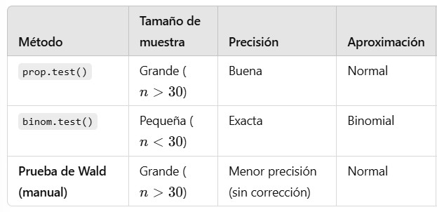

**Ejemplo 1:** Cuando Gregor Mendel llevó a cabo sus célebres experimentos de hibridación con guisantes, uno de ellos resultó en una descendencia de 428 plantas con vainas verdes y 152 plantas con vainas amarillas. Según su teoría, se esperaba que 1/4 de los descendientes tuvieran vainas amarillas. Utilizando un nivel de significancia de 0.05, realice una prueba de hipótesis para verificar la afirmación de que la proporción de plantas de guisantes con vainas amarillas es igual a 1/4.

Revisamos supuestos:

  1. Suponemos que la selección de plantas se obtuvo a través de un muestreo aleatorio simple.
  2. Tenemos dos posibles resultados: Vainas amarillas (éxito) y vainas verdes (fracaso)
  3. $np=580*0.25=145\geq5$ y $nq=580*0.75=435\geq5$

Planteamos el juego de hipótesis

$$
H_0: p = 1/4 \\
H_1: p \neq 1/4
$$
**Método Tradicional**

```{r}
#Calculamos el valor crítico
alpha <- 0.05
valor_critico_izquierda <- round(qnorm(alpha / 2, lower.tail = T),2)
valor_critico_izquierda
valor_critico_derecha <- round(qnorm(1 - alpha / 2, lower.tail = T),2)
valor_critico_derecha

#Calculamos el estadístico de prueba
estadistico_proporciones <- function(p_muestral, p_poblacional, n){
  z <- round((p_muestral - p_poblacional) / sqrt(p_poblacional * (1 - p_poblacional) / n),2)
  print(z)
}

estadistico_proporciones(152/580, 0.25, 580)
```

**Decisión:** Como el estadístico de prueba Z = 0.67 es menor que el valor crítico 1.96, no se rechaza la hipótesis nula.

**Conclusión:** Existe suficiente evidencia estadística para sustentar la aseveración de que 1/4 de las plantas tiene vainas amarillas, con un nivel de confianza al 95%.

**Método por Intervalos de Confianza**

```{r}
intervalo_p <- function(exitos, n, conf_level){
  p_muestral <- exitos / n
  q_muestral <- 1 - p_muestral
  alfa <- 1 -  conf_level
  v_critico <- round(qnorm(1 - alfa / 2, lower.tail = TRUE),3)
  error <- v_critico * sqrt(p_muestral * q_muestral / n)
  intervalo <- round(c(p_muestral - error, p_muestral + error),3)
  cat("Tenemos una confianza del", conf_level*100, "% de que el intervalo (", paste(intervalo, collapse = ","), ") realmente contiene el valor verdadero de 𝑝.\n")
}

intervalo_p(exitos = 152, n = 580, conf_level = 0.95)
```

**Decisión:** Como el valor aseverado 0.25 se encuentra dentro del intervalo de confianza, no se rechaza la hipótesis nula.

**Conclusión:** Existe suficiente evidencia estadística para sustentar la asevración de que 1/4 de las plantas tiene vainas amarillas, con un nivel de confianza al 95%.

**Método del p_value**

```{r}
# Tenemos una prueba de dos colas
# El estadístico de prueba es de 0.67
p_value <- 2 * pnorm(0.67, lower.tail = FALSE)
p_value
```

**Decisión:** Como p_value = 0.5028578 > 0.05 no se rechaza la hipótesis nula. 

**Conclusión:** Existe suficiente evidencia estadística para sustentar la asevración de que 1/4 de las plantas tiene vainas amarillas, con un nivel de confianza al 95%. 

```{r}
prueba_hipotesis_proporciones <- function(n, p_muestral, p_poblacional, alfa, tipo_prueba){
  #Calculo del estadístico de prueba
  z <- round((p_muestral - p_poblacional) / sqrt(p_poblacional * (1 - p_poblacional) / n),2)
  #Cálculo del valor crítico
  if(tipo_prueba == "izquierda"){
    valor_critico <- qnorm(alfa, lower.tail = T)
    p_value <- pnorm(z, lower.tail = T)
    conclusion <- ifelse(z < valor_critico, "Se rechaza H0", "No se rechaza HO")
  } else if(tipo_prueba == "derecha"){
    valor_critico <- qnorm(alfa, lower.tail = F)
    p_value <- pnorm(z, lower.tail = FALSE)
    conclusion <- ifelse(z > valor_critico, "Se rechaza H0", "No se rechaza H0")
  } else if(tipo_prueba == "dos colas"){
    valor_critico <- qnorm(alfa/2, lower.tail = TRUE)
    p_value <- 2 * pnorm(abs(z), lower.tail = FALSE)
    conclusion <- ifelse(abs(z) > abs(valor_critico), "Se rechaza H0", "No se rechaza H0")
  } else{
    stop("Tipo de prueba no válido. Usa 'izquierda', 'derecha' o 'dos_colas'.")
  }
    #Resultados
    cat("Estadístico de prueba (z):", z, "\n")
    cat("Valor crítico:", valor_critico, "\n")
    cat("p-valor:", p_value, "\n")
    cat("Conclusión:", conclusion, "\n")
}

prueba_hipotesis_proporciones(580, 152/580, 1/4, 0.05, "dos colas")
```

R proporciona varias funciones para pruebas de hipótesis para proporciones. 

  1. **Prueba de Wald** -> es similar a prop.test() pero sin corrección de continuidad.
  2. **prop.test** -> Prueba de proporciones basada en la aproximación normal.
  3. **binom.test** -> Prueba exacta de proporciones basada en la distribución binomial.



# **Prueba de chi-cuadrada de Pearson**

```{r}
prop.test(x = 152, n = 580, alternative = "two.sided", p = 0.25, conf.level = 0.95, correct = T)
```

**Decisión 1:** Como el valor del estadístico de prueba 0.38851 es menor que el valor crítico 1.96, no se rechaza la hipótesis nula.

**Decisión 2:** Como el valor aseverado 0.25 se encuentra dentro del intervalo de confianza 0.2271103 0.3002337, no se rechaza la hipótesis nula.

**Decisión 3:** Como p_value = 0.5331 > 0.05 no se rechaza la hipótesis nula. 

**Conclusión:** Existe suficiente evidencia estadística para sustentar la asevración de que 1/4 de las plantas tiene vainas amarillas, con un nivel de confianza al 95%. 


# **Prueba de la binomial exacta**

```{r}
binom.test(x = 152, n = 580, p = 0.25, alternative = "two.sided", conf.level = 0.95)
```

**Decisión 1:** Como el valor aseverado 0.25 se encuentra dentro del intervalo de confianza 0.2267068 0.2998745, no se rechaza la hipótesis nula.

**Decisión 2:** Como p_value = 0.5022 > 0.05 no se rechaza la hipótesis nula. 

**Conclusión:** Existe suficiente evidencia estadística para sustentar la asevración de que 1/4 de las plantas tiene vainas amarillas, con un nivel de confianza al 95%. 


**Problema 2** En un estudio de 11,000 accidentes automovilísticos seleccionados aleatoriamente por una compañía de seguros, se descubrió que 5586 de ellos ocurrieron a 8 km de casa del conductor. Utilice un nivel de significancia de 0.01 para probar la aseveración de que más del 50% de los accidentes automovilísticos ocurren dentro de 8 km de distancia de la casa del conductor.

```{r}
prueba_hipotesis_proporciones(11000, 5586/11000,0.50, 0.01, "derecha")
```

```{r}
prop.test(x = 5586, n = 11000, p = 0.50, alternative = "greater", conf.level = 0.99)
```

```{r}
binom.test(x = 5586, n = 11000, p = 0.50, alternative = "greater", conf.level = 0.99)
```

