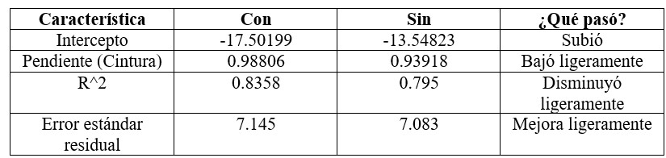

Cargamos librearías
```{r, warning=FALSE, message=FALSE}
library(readxl)
library(ggplot2)
library(dplyr)
library(gridExtra) # Forma de organizar los gráficos.
library(GGally)
library(corrplot)
library(car) # qqPlot de los residuales.
library(lmtest) # Prueba de autocorrelación de DW y prueba de Breusch-Pagan
library(nortest) # Prueba de KS
library(MASS)
library(caTools) # sample.split
library(tseries) #Prueba de Jarque Bera
```

Cargamos la base de datos
```{r}
Pulso <- read_excel("PulsoCardiacoMujeres.xlsx")
head(Pulso)
```

**Análisis Exploratorio**

Verificamos si tenemos la presencia de valores NA
```{r}
colSums(is.na(Pulso)) # No hay presencia de valores NA
```

Realizamos un resumen de estadísticas descriptivas de la variable de interés.
```{r}
summary(Pulso)
```
  
  - La mediana del contorno de la cintura es menor que la media, lo que sugiere una asimetría a la derecha.
  
  - El 25% de las mujeres de la muestra tienen una cintura mayor que 94.38
  
  - Existe una gran diferencia del contorno de la cintura entre el valor mínimo y el valor máximo.

Realizamos un boxplot y análisis de ouliers 
```{r}
boxplot(Pulso$Cintura) # No hay presencia de outliers en la variable de interés.
boxplot.stats(Pulso$Cintura)
```

  - Tenemos el valor del bigote inferior = 66.70 que coincide con el valor mínimo de los datos.
  
  - Tenemos el valor del bigote superior = 126.50 que coincide con el valor máximo de los datos.
  
  - No hay presencia de outliers en los datos.

Matriz de correlaciones


```{r}
matriz_corr <- cor(select_if(Pulso, is.numeric))
matriz_corr
```

Diagrama de calor para ver la matriz de correlaciones.
```{r}
corrplot(matriz_corr, method = "color", addCoef.col = "black")
```

  - Tenemos una correlación positiva muy fuerte entre la cintura y el peso de una mujer.
  
  - Tenemos una correlación positiva moderada entre las variables Peso - Edad y Cintura - Edad.
  
  - Tenemos una correlación positiva debil entre las demás variables.
  
Matriz de gráficos de dispersión
```{r}
pairs(Pulso, main = "Matriz de gráficos de dispersión", pch = 20, col =  "blue", lwd = 3)
# Es clara la correlación positiva entre el peso y la cintura de una mujer.
```

  - Se observa una relación directamente lineal entre la cintura y el peso.

Histogramas para cada variable
```{r}
variables <- c("Edad", "Estatura", "Peso", "Cintura", "Pulso")

#variables <- names(Pulso)[sapply(Pulso, is.numeric)]

par(mfrow = c(3, 2))  # 3 filas, 2 columnas (ajustable)

for (variable in variables) {
  datos <- Pulso[[variable]]
  hist(datos, probability = TRUE, main = paste("Distribución de", variable), xlab = variable, col = "salmon1", breaks = nclass.Sturges(datos))
  lines(density(datos), col = "black", lwd = 3)
  curve(dnorm(x, mean = mean(datos), sd = sd(datos)), add = TRUE, col = "blue", lwd = 3)
}
```


**Aplicación del Modelo**

Seleccionamos como nuestra variable de respuesta a "Peso" y nuestra variable predictora a "Cintura"

Dividir nuestros datos en datos de entrenamiento y datos de prueba.
```{r}
set.seed(42)

# Barajeamos la base de datos
barajeo <- slice_sample(Pulso, prop = 1)

# Dividimos aleatoriamente los datos
split <- sample.split(barajeo$Edad, SplitRatio = 0.8) # Vector lógico 

# Base de entrenamiento
train <- subset(barajeo, split == TRUE)

# Base de Prueba o Testeo
test <- subset(barajeo, split == FALSE)
```

Ajustamos el modelo con los datos de entrenamiento
```{r}
modelo <- lm(Peso ~ Cintura, data = train)
summary(modelo)
```

El modelo ajustado es:
$$
\hat{Peso} = -17.50199 + 0.98806 *Cintura
$$

**Elementos del Modelo:**

test Fisher: 

En regresión simple, el test F se utiliza para probar si el modelo con la variable explicativa es significativamente mejor que un modelo que solo incluye la media. El juego de hipótesis que se plantea es:

$$
H_0: \beta_1 = 0 \\
H_1: \beta_1 \neq 0
$$
  - En el test de Fisher tenemos un p-value: 2.669e-13 < 0.05 se rechaza la hipótesis nula en favor de la alternativa. Por lo tanto, existe suficiente evidencia estadística para sustentar la aseveración de que al menos una beta es diferente de cero.

Coeficientes:

  - El p-valor de la variable "Cintura" y el intercepto son menores que el nivel de significancia, indicando que son significativas para el modelo.
  
  - Intersección (Intercept) = -17.50199: Cuando la variable Cintura = 0, el modelo predice que el peso sería aproximadamente -17.50199 kg. Esta interpretación no tiene sentido práctico, ya que una cintura de 0 cm no es realista. Sin embargo, el intercepto es necesario para calcular los valores ajustados.
  
  - Pendiente (Cintura) = 0.98806: Por cada aumento de 1 cm en la cintura, el peso promedio aumenta en 0.98806 kg.

Residuales:

  - La mediana de los residuos 0.2585 es cercana a 0, lo cual sugiere que el modelo no tiene un sesgo fuerte en la predicción ya que el error típico está cercano a cero.
  
  - Aunque el modelo se ajusta bastante bien, hay algunos errores (residuos) un poco grandes.

R-squared
  
  - El modelo explica el 83.58% de la variabilidad en el peso usando la cintura como predictor. Esto indica un ajuste fuerte. El porcentaje restante (100% - 83.58% = 16.42%) de la variabilidad en el Peso no está explicado por la Cintura y se atribuye a otros factores no incluidos en el modelo o al error aleatorio.
  
```{r}
# Gráfico de dispersión con línea de regresión
plot(train$Cintura, train$Peso, col='blue3', pch = 16, xlab = "Cintura", ylab = "Peso", main = "Regresión Lineal: Peso ~ Cintura", lwd = 5)
abline(modelo, col='red', lwd = 2)
```

**Verificamos supuestos de e**

Supuesto 1: La media de la distribución de probabilidad de e es cero. 
```{r}
summary(residuals(modelo)) # Se cumple
```

Supuesto 2: La varianza de la distribución de probabilidad de e es constante.

Homocedasticida (Igualdad de varianzas): La igualdad de varianzas se espera entre los residuos y los valores ajustados del modelo.

```{r}
plot(fitted(modelo), residuals(modelo), col = 'blue', pch = 16, main = 'Fitted vs Residuals')
abline(h=0, col='red')
# fitted(modelo): Son los valores ajustados o predichos por tu modelo. 
# residuals(modelo): Son los residuos.
```

  - Como los puntos están dispersos de forma aleatoria arriba y abajo de la línea roja y no hay patrones se sugiere que si hay homocedasticidad.

La Prueba de **Breusch-Pagan** es una prueba estadística que se utiliza para detectar la heterocedasticidad en un modelo de regresión lineal. La heterocedasticidad ocurre cuando la varianza de los errores o residuos no es constante a lo largo de las observaciones, lo que violaría una de las suposiciones básicas de los modelos de regresión lineal (homocedasticidad).

$H_0:$ La varianza de los errores es constante (homocedasticidad)
$H_1:$ La varianza de los errores no es constante (heterocedasticidad)

```{r}
bptest(modelo)
```

  - Como p-value = 0.1744 > 0.05 no se rechaza la hipótesis nula. Por lo tanto, existe suficiente evidencia estadística para sustentar la aseveración de que la varianza de los errores es constante.

Supuesto 3: La distribución de probabilidad de e es normal. 

```{r}
# Histograma de los residuales
hist(residuals(modelo), probability = T,col='salmon', main='Histograma de residuos', breaks = nclass.Sturges(modelo$residuals))
lines(density(residuals(modelo)), col = "black", lwd = 3)
curve(dnorm(x, mean(residuals(modelo)), sd(residuals(modelo))), col = "red3", lwd = 3, add = T)
```

```{r}
# QQ-NORM
qqPlot(residuals(modelo), pch = 20, col = "black", lwd = 2)
```

```{r}
# test de normalidad
shapiro.test(residuals(modelo)) # Si hay normalidad en los residuales.
```

  - Como p-value = 0.6137 > 0.05 no se rechaza la hipótesis nula. Por lo tanto, existe suficiente evidencia estadística para sustentar la aseveración de que los residuales siguen una distribución significativamente normal.

```{r}
jarque.bera.test(residuals(modelo))
```

  - Como p-value = 0.652 > 0.05 no se rechaza la hipótesis nula. Por lo tanto, existe suficiente evidencia estadística para sustentar la aseveración de que los residuos siguen una distribución normal.
  
Supuesto 4: Los errores asociados con dos observaciones diferentes son independentes. 

La prueba de **Durbin-Watson** evalúa si existe autocorrelación de primer orden en los residuos del modelo de regresión, es decir, si los errores están correlacionados entre sí (especialmente entre un error y el anterior).

$H_0:$ No hay autocorrelación en los residuos (es decir, los residuos son independientes entre sí).
$H_1:$ Sí hay autocorrelación en los residuos

El estadístico de Durbin Watson toma valores entre 0 y 4:
  
  - DW ≈ 2 → No hay autocorrelación
  
  - DW < 2 → Autocorrelación positiva
  
  - DW > 2 → Autocorrelación negativa
  
```{r}
# Prueba de Durbin-Watson para autocorrelación de residuos
dwtest(modelo)
```
 
  - Como DW = 2.2082 lo cual está muy cerca de 2, entonces no hay evidencia de autocorrelación significativa. Esto indica que los errores del modelo son independientes.
  
  - Como p-value = 0.7528 > 0.05 no se rechaza la hipótesis nula. Por lo tanto, existe suficiente evidencia estadística para sustentar la aseveración de que no hay autocorrelación entre los residuos.
  
**Predicciones**
  
```{r}
# Predicciones en el conjunto de prueba
predicciones <- predict(modelo, newdata = test, interval = "confidence", level = 0.95)

# Guardar las predicciones y los intervalos de confianza en el conjunto de prueba
test$predicted <- predicciones[,1]
test$lower <- predicciones[,2]
test$upper <- predicciones[,3]

# Ver el conjunto de prueba con las nuevas columnas de predicciones
test
```


**Valores Influyentes**

cook.d: El estadístico de Cook (cook.d) es una medida que evalúa la influencia de una observación en el modelo de regresión en general. Básicamente, mide cuánto cambiarían los resultados del modelo si esa observación fuera eliminada. Si el valor de Cook es grande (generalmente mayor que 1), indica que esa observación tiene un gran impacto en los resultados del modelo y podría ser considerada influyente. 


hat: La palanca (hat) mide cuán influyente es una observación en la predicción de su propio valor dentro del modelo. Si una observación tiene una palanca alta, significa que un pequeño cambio en esa observación podría afectar mucho su propia predicción, lo que indica que tiene un impacto considerable en cómo el modelo la interpreta. Esto también puede influir indirectamente en las predicciones de otras observaciones, ya que cambia la forma en que el modelo ajusta su estructura general.

El hat value (hat) mide qué tan extremo es el valor del predictor (en tu caso, la cintura) con respecto a las demás observaciones.


```{r}
# Evaluamos los valores influyentes
influencia <- influence.measures(modelo)

# Mostramos las medidas de influencia
summary(influencia)

p <- 2
n <- nrow(train)
umbral1 <- 2 * (p/n)
umbral2 <- 3 * (p/n)
cat("Umbral de leverage sospechoso:", round(umbral1, 4), "\n")
cat("Umbral de leverage alto:", round(umbral2, 4), "\n")
```

Observación 8:

  - cook.d = 0.07: Este valor es relativamente bajo. Por lo tanto, esta observación probablemente no tiene una influencia sustancial en la estimación global del modelo.

  - hat = 0.03: Este valor de palanca es bajo. Indica que la variable independiente (Cintura) de esta observación no es particularmente inusual en el conjunto de datos y, por lo tanto, no tiene una gran influencia en la predicción de su propio valor de Peso.

Observación 11:

  cook.d = 0.00: Esto es un valor muy bajo, cercano a cero. Por lo tanto, esta observación probablemente no tiene una influencia fuerte en el modelo en general.

  hat = 0.22: Este valor de "hat" es relativamente alto. Esto indica que el valor de la Cintura para esta observación es algo inusual en el conjunto de datos y, por lo tanto, tiene una influencia considerable en su propia predicción de Peso. 

Observación 13:

  - cook.d = 0.17: Este valor es bajo, aunque ligeramente mayor que el de la observación 8. Aún así, no sugiere una influencia grande en la estimación global del modelo.

  - hat = 0.05: Este valor de palanca también es bajo, indicando que la Cintura de esta observación no es atípica y, por lo tanto, no tiene una gran influencia en su propia predicción de Peso.

Observación 26:

  - cook.d = 0.22: Este valor es más elevado que los anteriores. Si bien no supera el umbral de 1, sugiere una influencia moderada en la estimación del modelo. La eliminación de esta observación podría causar un cambio notable en los coeficientes.

  - hat = 0.22: Similar a la observación 11, este valor de palanca es alto. Indica que el valor de la Cintura para esta observación es inusual y tiene una influencia considerable en su propia predicción de Peso. La combinación de un cook.d moderadamente alto y una palanca alta sugiere que esta observación merece una atención especial, ya que podría estar afectando el ajuste del modelo..

```{r}
# Graficar influencia
plot(modelo, which = 4:5)
```

  - Eje X (Leverage): qué tan extremo es el valor de la cintura comparado con las demás (valores extremos de cintura → más a la derecha).

  - Eje Y (Residuos estandarizados): cuán alejado está el valor real del peso respecto al valor predicho por el modelo.

  - Líneas curvas grises: representan niveles de la distancia de Cook (cook.d). Si un punto está cerca o sobre las curvas, está influyendo en los coeficientes del modelo.
  
  - El punto 26 presenta un leverage alto (0.22), lo que indica que su valor de cintura es considerablemente diferente al del resto de las observaciones. Además, su residuo estandarizado (1.0), aunque no extremo, en combinación con su posición cercada a la curva de distancia de Cook (0.5) sugiere que esta observación tiene un impacto potencial en los coeficientes del modelo.
  
  - El punto 13 tiene un residuo estandarizado elevado (~2.5), lo que indica que el modelo subestima o sobrestima en gran medida el peso de esta observación respecto al valor real. Sin embargo, su leverage es bajo (~0.06), lo que implica que su valor de cintura no se desvía mucho del promedio de la muestra. Por tanto, aunque el modelo comete un error importante con esta observación, no tiene un impacto significativo en la estimación de los coeficientes. 
  
  - El punto 2 presenta un residuo estandarizado negativo considerable (~ -2), lo que indica que el modelo sobreestima el peso real de la observación. No obstante, su leverage es bajo, lo que significa que su valor de cintura se encuentra dentro del rango común del resto de los datos.
  
```{r}
train[c(2,13,26),]
```


#**Modelo 2**

Probamos el modelo sin la observación 26
```{r}
train2 <- train[-26,]
```

Ajustamos el modelo con los datos de entrenamiento
```{r}
modelo2 <- lm(Peso ~ Cintura, data = train2)
summary(modelo2)
```

El modelo ajustado es:
$$
\hat{Peso} = -13.54823 + 0.93918 *Cintura
$$



  - La observación 26 era influyente ya que su presencia hacía que el intercepto fuera más bajo.
  
  - El coeficiente de cintura cambió moderadamente, pero relevante si usas el modelo para predicciones.
  
  - La observación 26 ayudaba a que el modelo explicara el 83.56% de la variabilidad y sin él baja al 79.5%.
  
  - En conclusión, la observación 26 si es influyente ya que al quitarla el modelo cambia pero no se destruye y el ajuste sigue siendo bueno pero un poco menos explicativo.

  - En el test de Fisher tenemos un p-value: 2.669e-13 < 0.05 se rechaza la hipótesis nula en favor de la alternativa. Es decir, tenemos al menos una beta diferente de cero.

```{r}
# Gráfico de dispersión con línea de regresión
plot(train2$Cintura, train2$Peso, col='blue3', pch = 16, xlab = "Cintura", ylab = "Peso", main = "Regresión Lineal: Peso ~ Cintura", lwd = 5)
abline(modelo2, col='red', lwd = 2)
```

**Verificamos supuestos de e**

Supuesto 1: La media de la distribución de probabilidad de e es cero. 
```{r}
summary(residuals(modelo2)) # Se cumple
```

Supuesto 2: La varianza de la distribución de probabilidad de e es constante.

Homocedasticida (Igualdad de varianzas): La igualdad de varianzas se espera entre los residuos y los valores ajustados del modelo.

```{r}
plot(fitted(modelo2), residuals(modelo2), col = 'blue', pch = 16, main = 'Fitted vs Residuals')
abline(h=0, col='red')
# fitted(modelo): Son los valores ajustados o predichos por tu modelo. 
# residuals(modelo): Son los residuos.
```

  - Como los puntos están dispersos de forma aleatoria arriba y abajo de la línea roja y no hay patrones se sugiere que si hay homocedasticidad.

La Prueba de **Breusch-Pagan**

$H_0:$ La varianza de los errores es constante (homocedasticidad)
$H_1:$ La varianza de los errores no es constante (heterocedasticidad)

```{r}
bptest(modelo2)
```

  - Como p-value = 0.1898 > 0.05 no se rechaza la hipótesis nula. Por lo tanto, existe suficiente evidencia estadística para sustentar la aseveración de que la varianza de los errores es constante.

Supuesto 3: La distribución de probabilidad de e es normal. 

```{r}
# Histograma de los residuales
hist(residuals(modelo2), probability = T,col='salmon', main='Histograma de residuos', breaks = nclass.Sturges(modelo2$residuals))
lines(density(residuals(modelo2)), col = "black", lwd = 3)
curve(dnorm(x, mean(residuals(modelo2)), sd(residuals(modelo2))), col = "red3", lwd = 3, add = T)
```

```{r}
# QQ-NORM
qqPlot(residuals(modelo2), pch = 20, col = "black", lwd = 2)
```

```{r}
# test de normalidad
shapiro.test(residuals(modelo2)) # Si hay normalidad en los residuales.
```

  - Como p-value = 0.2991 > 0.05 no se rechaza la hipótesis nula. Por lo tanto, existe suficiente evidencia estadística para sustentar la aseveración de que los residuales siguen una distribución significativamente normal.

```{r}
jarque.bera.test(residuals(modelo2))
```

  - Como p-value = 0.3491 > 0.05 no se rechaza la hipótesis nula. Por lo tanto, existe suficiente evidencia estadística para sustentar la aseveración de que los residuos siguen una distribución normal.
  
Supuesto 4: Los errores asociados con dos observaciones diferentes son independentes. 

$H_0:$ No hay autocorrelación en los residuos (es decir, los residuos son independientes entre sí).
$H_1:$ Sí hay autocorrelación en los residuos

El estadístico de Durbin Watson toma valores entre 0 y 4:
  
  - DW ≈ 2 → No hay autocorrelación
  
  - DW < 2 → Autocorrelación positiva
  
  - DW > 2 → Autocorrelación negativa
  
```{r}
# Prueba de Durbin-Watson para autocorrelación de residuos
dwtest(modelo2)
```
 
  - Como DW = 2.1106 lo cual está muy cerca de 2, entonces no hay evidencia de autocorrelación significativa. Esto indica que los errores del modelo son independientes.
  
  - Como p-value = 0.6448 > 0.05 no se rechaza la hipótesis nula. Por lo tanto, existe suficiente evidencia estadística para sustentar la aseveración de que no hay autocorrelación entre los residuos.

**Predicciones**

```{r}
# Predicciones en el conjunto de prueba
test2 <- test[,c(1:5)]
predicciones2 <- predict(modelo2, newdata = test2, interval = "confidence", level = 0.95)

# Guardar las predicciones y los intervalos de confianza en el conjunto de prueba
test2$predicted <- predicciones2[,1]
test2$lower <- predicciones2[,2]
test2$upper <- predicciones2[,3]

# Ver el conjunto de prueba con las nuevas columnas de predicciones
test
test2
```