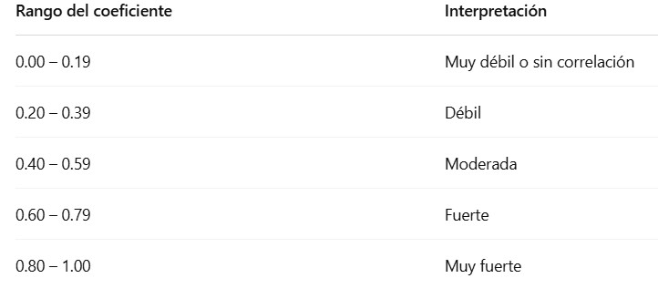
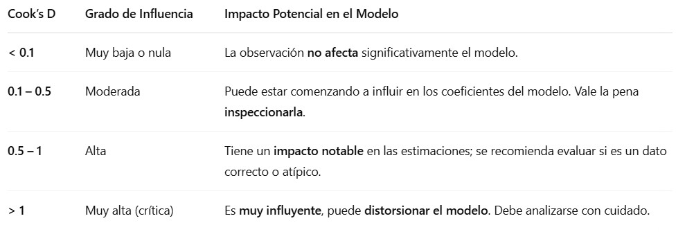
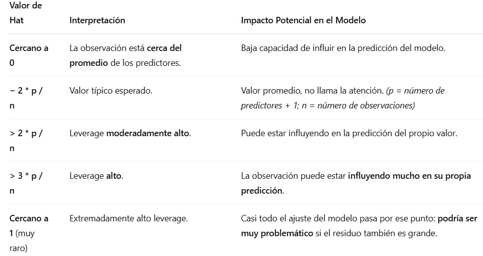

Cargamos librearías
```{r, warning=FALSE, message=FALSE}
library(readxl)
library(ggplot2)
library(dplyr)
library(gridExtra) # Forma de organizar los gráficos.
library(GGally)
library(corrplot)
library(car) # qqPlot de los residuales.
library(lmtest) # Prueba de autocorrelación de DW
library(nortest) # Prueba de KS
library(MASS)
library(caTools) # sample.split
library(tseries) #Prueba de Jarque Bera
```

Problema:

Una institución educativa desea identificar qué hábitos y antecedentes tienen mayor impacto en el rendimiento académico de sus estudiantes. Para ello, dispone de una base de datos con información sobre 10,000 alumnos, incluyendo:

  Hours Studied: Horas de estudio
  
  Previous Scores: Puntajes anteriores
  
  Extracurricular Activities: Participación en actividades extracurriculares
  
  Sleep Hours: Horas promedio de sueño
  
  Sample Question Papers Practiced: Cantidad de guías de práctica resueltas
  
  Performance Index: Índice de rendimiento (variable objetivo)

Cargamos la base de datos
```{r}
df_estudiantes <- read_excel("Student_Performance.xlsx")
head(df_estudiantes)
```

**Análisis Exploratorio**

Verificamos si tenemos la presencia de valores NA
```{r}
colSums(is.na(df_estudiantes)) # No hay presencia de valores NA
```

Realizamos un resumen de estadísticas descriptivas
```{r}
summary(select_if(df_estudiantes, is.numeric))
```

```{r}
variables <- names(select_if(df_estudiantes, is.numeric))

# Configura una ventana de gráficos
par(mfrow = c(2,3))  # 2 filas, 3 columnas

# Recorremos cada variable para graficarla
for (var in variables) {
  datos <- df_estudiantes[[var]]
  boxplot(datos, col = "salmon", main = paste("Boxplot de", var), ylab = var)
  # Mostrar estadísticas del boxplot en la consola
  print(paste("Estadísticas del boxplot para:", var))
  print(boxplot.stats(datos))
}
```

Matriz de correlaciones
```{r}
matriz_corr <- cor(select_if(df_estudiantes, is.numeric))
matriz_corr
```

Diagrama de calor para ver la matriz de correlaciones.
```{r}
corrplot(matriz_corr, method = "color", addCoef.col = "black")
```



  - Hay una correlación muy fuerte entre el índice de rendimiento y puntajes anteriores.
  
  - Hay una correlación debil entre el índice de rendimiento y horas de estudio.
  
  - Hay una correlación muy débil entre el índice de rendimiento con horas de sueño y cantidad de guías resueltas.
  
Matriz de gráficos de dispersión
```{r}
pairs(select_if(df_estudiantes, is.numeric), main = "Matriz de gráficos de dispersión")
# Es clara la correlación positiva entre el peso y la cintura de una mujer.
```

  - Es clara la correlación positiva entre el índice de rendimiento y puntajes anteriores.

Histogramas para cada variable
```{r}
variables <- names(select_if(df_estudiantes, is.numeric))

# Configura una ventana de gráficos
par(mfrow = c(2, 3))  # 2 filas, 3 columnas

# Recorremos cada variable para graficarla
for (var in variables) {
  datos <- df_estudiantes[[var]]
  hist(datos, probability = TRUE, main = paste("Distribución de", var), xlab = var, col = "salmon1", breaks = nclass.Sturges(datos))
  lines(density(datos), col = "black", lwd = 3)
  curve(dnorm(x, mean = mean(datos), sd = sd(datos)), add = TRUE, col = "blue", lwd = 3)
}
```

#**Modelo 1**

**Aplicación del Modelo**

Dividir nuestros datos en datos de entrenamiento y datos de prueba.
```{r}
set.seed(42)

# Barajeamos la base de datos
barajeo <- slice_sample(df_estudiantes, prop = 1)

# Dividimos aleatoriamente los datos
split <- sample.split(barajeo$`Hours Studied`, SplitRatio = 0.8) # Vector lógico 

# Base de entrenamiento
train <- subset(barajeo, split == TRUE)

# Base de Prueba o Testeo
test <- subset(barajeo, split == FALSE)
```

Ajustamos el modelo con los datos de entrenamiento
```{r}
modelo <- lm(`Performance Index` ~ ., data = train)
summary(modelo)
```

  - El valor p de la prueba de Fisher es p-value: < 2.2e-16 < 0.05, lo que nos lleva a rechazar la hipótesis nula en favor de la alternativa. Es decir, al menos una de las variables predictoras tiene un efecto significativo en la variable price.
  
  - Los residuos tienen una dispersión baja (min: -8.6536, max: 8.7674), lo que sugiere que no hay variabilidad significativa en los errores del modelo.
  
  - El error típico -0.0351 está muy cerca de 0, lo cual es buena señal para el modelo.

  - El modelo explica el 98.89% de la variabilidad del índice de rendimiento.
  
  - Como el valor ajustado es 98.89%, eso indica que todas las variables del modelo están aportando y no hay relleno innecesario.
  
  - Por cada hora adicional de estudio, el índice de rendimiento aumenta en 2.85 puntos.
  
  - Por cada punto adicional en los exámenes anteriores, el índice de rendimiento aumenta en 1.02 puntos.
  
  - Los estudiantes que participan en actividades extracurriculares tienen, en promedio, 0.60 puntos más en su índice de rendimiento que los que no participan.
  
  - Cada hora adicional de sueño al día se asocia con un aumento de 0.48 puntos en el índice de rendimiento.
  
  - Cada guía adicional practicada incrementa el índice en 0.20 puntos, manteniendo constantes las demás variables.
  
**Verificamos supuestos**

Primer supuesto: Media de los residuales
```{r}
summary(residuals(modelo)) # Podemos observar que su media es de 0.
```

Segundo supuesto: Varianza constante (Homocedasticidad). Test de Breusch - Pagan

  - $H_0:$ La varianza de los errores es constante (homocedasticidad)
  
  - $H_1:$ La varianza de los errores no es constante (heterocedasticidad)
  
```{r}
plot(fitted(modelo), residuals(modelo), col = 'blue', pch = 16, main = 'Fitted vs Residuals', cex = 0.01)
abline(h=0, col='red')
# Como los puntos están dispersos de forma aleatoria arriba y abajo de la línea roja y no hay patrones se sugiere que si hay homocedasticidad.

bp_test <- bptest(modelo)
bp_test
if (bp_test$p.value > 0.05){
  cat("Como p_value =", bp_test$p.value, "> 0.05, no se rechaza la hipótesis \n")
  cat("Por lo tanto, la varianza de los errores es constante (hay homocedasticidad)")
} else{
  cat("Como p_value =", bp_test$p.value, "< 0.05, se rechaza la hipótesis en favor de la alternativa \n")
  cat("Por lo tanto, la varianza de los errores no es constante (hay heterocedasticidad)")  
}
```
 
Tecer Supuesto: Normalidad de los residuos. Test Jarque - Bera

  - $H_0:$ Los residuos siguen una distribución normal (sin sesgo ni curtosis excesiva)
  
  - $H_1:$ Los residuos no siguen una distribución normal (pueden tener sesgo y curtosis fuera de los parámetros normales)

```{r}
hist(residuals(modelo), col='blue', main='Histograma de residuos', breaks = nclass.Sturges(modelo$residuals))
qqPlot(residuals(modelo))
boxplot(residuals(modelo), main='Diagrama de caja de residuos') # Su mediana es aproximadamente cero y no hay outliers.

jb_test <- jarque.bera.test(residuals(modelo))
jb_test
if (jb_test$p.value > 0.05){
  cat("Como p_value =", jb_test$p.value, "> 0.05, no se rechaza la hipótesis nula \n")
  cat("Por lo tanto, los residuos siguen una distribución normal")
} else{
  cat("Como p_value =", jb_test$p.value, "< 0.05, se rechaza la hipótesis nula en favor de la alternativa \n")
  cat("Por lo tanto, los residuos no siguen una distribución normal")  
}
```

Resiudos independientes. Test Durbin - Watson

  - $H_0:$ No hay autocorrelación en los residuos
  
  - $H_1:$ Sí hay autocorrelación en los residuos
  
```{r}
dw_test <- dwtest(modelo)
dw_test
if (dw_test$p.value > 0.05){
  cat("Como p_value =", dw_test$p.value, "> 0.05, no se rechaza la hipótesis \n")
  cat("Por lo tanto, no hay autocorrelación en los residuos")
} else{
  cat("Como p_value =", dw_test$p.value, "< 0.05, se rechaza la hipótesis en favor de la alternativa \n")
  cat("Por lo tanto, sí hay autocorrelación en los residuos")  
}
```

```{r}
# Solo seleccionamos las variables predictoras del modelo
X <- model.matrix(~ ., data = train)[,-1]  # Quitamos intercepto
kappa(X)  # Esto te da un valor más preciso
```

Un número de condición de 127. 5211 indica una multicolinealidad alta. Esto sugiere que algunas variables independientes están muy correlacionadas entre sí.

**Predicciones**
  
```{r}
# Predicciones en el conjunto de prueba
predicciones <- predict(modelo, newdata = test, interval = "confidence", level = 0.95)

# Guardar las predicciones y los intervalos de confianza en el conjunto de prueba
test$predicted <- predicciones[,1]
test$lower <- predicciones[,2]
test$upper <- predicciones[,3]

# Ver el conjunto de prueba con las nuevas columnas de predicciones
test
```

**Valores Influyentes**





```{r}
influencia <- influence.measures(modelo)

# Mostramos las medidas de influencia
summary(influencia)

p <- 6
n <- nrow(train)
umbral1 <- 2 * (p/n)
umbral2 <- 3 * (p/n)
cat("Umbral de leverage sospechoso:", round(umbral1, 4), "\n")
cat("Umbral de leverage alto:", round(umbral2, 4), "\n")
```

  - No hay valores influyentes.

```{r}
plot(modelo, which = 4:5)
```
  
  - La mayoría de los puntos están concentrados en el centro.
  
  - Todos los puntos se encuentran por abajo del primer umbral de Leverage 0.0015.
  
  - Todas las observaciones tienen una distancia de Cook por abajo de 0.1 lo que indica que no afectan al modelo.
  

**Modelo 2 Forward**

En el modelo Forward o Selección hacia adelante, el proceso comienza con un modelo vacío (es decir, sin ninguna variable predictora) y se van agregando variables una por una. En cada paso, se agrega la variable que, al ser incorporada al modelo, mejora más el ajuste (por ejemplo, en términos de reducción del AIC, R² o alguna otra métrica de ajuste). Este proceso continúa hasta que agregar más variables no mejora significativamente el modelo o no hay más variables para agregar.

Ventajas: Es útil cuando tienes un gran número de variables y no quieres comenzar con todas. Permite ir incorporando gradualmente las variables que realmente aportan al modelo.

Desventajas: Puede ser menos eficiente si el modelo no está bien especificado desde el inicio y puede llevar a sobreajuste si no se controla bien el proceso.

```{r}
# Modelo nulo: solo el intercepto
modelo_nulo <- lm(`Performance Index` ~ 1, data = train)

# Modelo completo: con todas las variables como predictores
modelo_completo <- lm(`Performance Index` ~ ., data = train)

# Selección hacia adelante (Forward)
modelo_forward <- step(modelo_nulo,
                       scope = formula(modelo_completo),
                       direction = "forward")

# Resumen del modelo seleccionado
summary(modelo_forward)
```


#**Modelo 3 Backward**

En el modelo Backward o Selección hacia atrás, el proceso comienza con un modelo completo (que incluye todas las variables predictoras) y luego se van eliminando las variables una por una. En cada paso, se elimina la variable menos significativa (que tiene el mayor valor p o que no mejora el modelo en términos de ajuste). Este proceso continúa hasta que eliminar más variables empeore el modelo.

Ventajas: Es útil cuando se tiene un modelo con muchas variables y se quiere simplificar el modelo eliminando aquellas que no aportan significativamente.

Desventajas: Requiere que el modelo inicial esté bien especificado, ya que eliminar variables podría tener efectos no deseados si las variables son relevantes pero no significativas de manera inmediata debido a colinealidad u otros factores.

```{r}
modelo_completo <- lm(`Performance Index` ~ ., data = train)

# Aplicamos la selección hacia atrás
modelo_backward <- step(modelo_completo, 
                        direction = "backward")

# Resumen del modelo
summary(modelo_backward)
```
