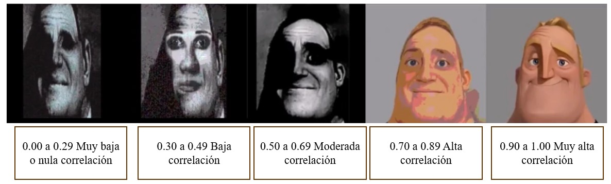
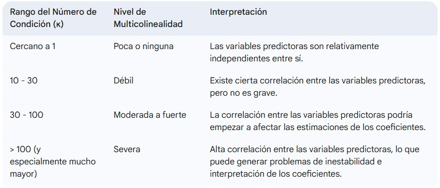
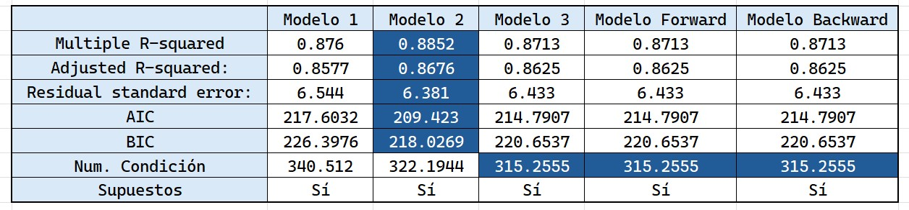

Cargamos librearías
```{r, warning=FALSE, message=FALSE}
library(readxl)
library(ggplot2)
library(dplyr)
library(gridExtra) # Forma de organizar los gráficos.
library(GGally)
library(corrplot)
library(car) # qqPlot de los residuales.
library(lmtest) # Prueba de autocorrelación de DW
library(nortest) # Prueba de KS
library(MASS)
library(caTools) # sample.split
library(tseries) #Prueba de Jarque Bera
```

Cargamos la base de datos
```{r}
Pulso <- read_excel("PulsoCardiacoMujeres.xlsx")
head(Pulso)
```

**Análisis Exploratorio**

Verificamos si tenemos la presencia de valores NA
```{r}
colSums(is.na(Pulso)) # No hay presencia de valores NA
```

Realizamos un resumen de estadísticas descriptivas
```{r}
summary(Pulso)
```

  - Para las variables Edad, Peso, Cintura y Pulso la mediana es menor que la media, lo que sugiere que la distribución pueda presentar una asimetría a la derecha.
  
  - En cuestión del pulso, el estándar normal es de 60 a 100 latidos por minuto. En este caso, el 25% de la mujeres de la muestra tienen 80 o más pulsaciones por minuto. 

```{r}
# Seleccionamos el nombre de nuestra variables
variables <- names(select_if(Pulso, is.numeric))

# Configuramos una ventana de gráficos
par(mfrow = c(2,3))  # 2 filas, 3 columnas

# Recorremos cada variable para graficarla
for (var in variables) {
  datos <- Pulso[[var]]
  boxplot(datos, col = "salmon", main = paste("Boxplot de", var), ylab = var)
}
```

```{r}
for(var in variables){
  datos <- Pulso[[var]]
  cat("Estadísticas del boxplot para: ", var, "\n")
  print(boxplot.stats(datos))
}
```

  - La variable peso tiene dos valores outliers que son 107.3 y 115.2
  
  - La variable Pulso tiene dos valores outliers que son 104 y 124

Matriz de correlaciones



```{r}
matriz_corr <- cor(select_if(Pulso, is.numeric))
matriz_corr
```

Diagrama de calor para ver la matriz de correlaciones.
```{r}
corrplot(matriz_corr, method = "color", addCoef.col = "black")
```

  - Tenemos una correlación positiva muy alta entre la cintura y el peso de una mujer.
  
  - Tenemos una correlación positiva moderada entre las variables Peso y Edad y también entre Cintura y Edad.
  
  - Tenemos una correlación positiva baja entre las variables Pulso y Edad, Peso y Estatura.
  
  - Tenemos una correlación positiva muy baja entre las demás variaables.
  

Matriz de gráficos de dispersión
```{r}
pairs(Pulso, main = "Matriz de gráficos de dispersión")
# Es clara la correlación positiva entre el peso y la cintura de una mujer.
```

  - Existe una correlación positiva notable entre el Peso y la Cintura: A medida que el peso tiende a aumentar, la cintura también muestra una tendencia a incrementarse.
  
  - La Estatura muestra una ligera tendencia positiva con el Peso: Aunque la relación no es tan fuerte como entre Peso y Cintura, se puede apreciar una leve tendencia a que las mujeres más altas tengan un peso ligeramente mayor.
  
  - El Pulso parece tener poca o ninguna relación lineal clara con las otras variables (Edad, Estatura, Peso, Cintura): Los gráficos que involucran el Pulso muestran una dispersión de puntos más aleatoria, sin una dirección clara ascendente o descendente. 

Histogramas para cada variable
```{r}
# Configuramos una ventana de gráficos
par(mfrow = c(3, 2))  # 3 filas, 2 columnas

# Recorremos cada variable para graficarla
for (var in variables) {
  datos <- Pulso[[var]]
  hist(datos, probability = TRUE, main = paste("Distribución de", var), xlab = var, col = "salmon1", breaks = nclass.Sturges(datos))
  lines(density(datos), col = "black", lwd = 3)
  curve(dnorm(x, mean = mean(datos), sd = sd(datos)), add = TRUE, col = "blue", lwd = 3)
}
```

**Aplicación del Modelo**

Seleccionamos como nuestra variable de respuesta a "Peso" y nuestras variables predictoras a todas las demas.

Dividir nuestros datos en datos de entrenamiento y datos de prueba.
```{r}
set.seed(42)

# Barajeamos la base de datos
barajeo <- slice_sample(Pulso, prop = 1)

# Dividimos aleatoriamente los datos
split <- sample.split(barajeo$Edad, SplitRatio = 0.8)

# Base de entrenamiento
train <- subset(barajeo, split == TRUE)

# Base de Prueba o Testeo
test <- subset(barajeo, split == FALSE)
```

Ajustamos el modelo con los datos de entrenamiento
```{r}
modelo <- lm(Peso ~ ., data = train)
summary(modelo)
AIC(modelo); BIC(modelo)
```

El modelo ajustado es:

$$
\hat{Peso}=-95.898129-0.130789 ∗Edad+48.803620∗Estatura+1.027751∗Cintura+0.0076117 ∗Pulso
$$
  
  - El valor p de la prueba de Fisher es 7.377e-12 < 0.05, lo que nos lleva a rechazar la hipótesis nula en favor de la alternativa. Esto significa que al menos una de las variables predictoras incluidas (Edad, Estatura, Cintura, Pulso) tiene una relación lineal con el Peso.
  
  - Las variables **Estatura**, **Cintura** y el **intercepto** son significativas para el modelo ya que su p_value son menores que 0.05.
  
  - Las variables **Edad** y **Pulso** no son significativas para el modelo al tener un p_value mayor que 0.05.
  
  - Manteniendo las demás variables constantes, por cada centímetro adicional en la cintura, se espera un aumento promedio de aproximadamente 1.03 kg en el peso.
  
  - Manteniendo las demás variables constantes, por cada metro adicional en la estatura, se espera un aumento promedio de aproximadamente 48.80 kg en el peso.
  
  - El intercepto de -95.90 kg representa el peso predicho cuando todas las variables predictoras son cero. En este contexto específico, esta interpretación no tiene un significado práctico directo ya que una persona no puede tener una edad, estatura, cintura y pulso de cero simultáneamente. Sin embargo, es un componente necesario del modelo.
  
  - El R-cuadrado múltiple es de 0.876, lo que significa que aproximadamente el 87.6% de la variabilidad observada en el Peso puede ser explicada por el modelo que incluye la Edad, la Estatura, la Cintura y el Pulso.
  
  - El R-cuadrado ajustado es de 0.858, que también indica una alta proporción de variabilidad explicada, penalizando ligeramente por la inclusión de predictores que no necesariamente contribuyen significativamente al modelo (como la Edad y el Pulso en este caso).
  
**Verificamos supuestos**

Supuesto 1: La media de la distribución de probabilidad de e es cero. 
```{r}
summary(residuals(modelo)) # Podemos observar que su media es de 0.
```

Supuesto 2: La varianza de la distribución de probabilidad de e es constante.

Test de Breusch - Pagan

  - $H_0:$ La varianza de los errores es constante (homocedasticidad)
  
  - $H_1:$ La varianza de los errores no es constante (heterocedasticidad)
  
```{r}
plot(fitted(modelo), residuals(modelo), col = 'blue', pch = 16, main = 'Fitted vs Residuals')
abline(h=0, col='red')
```

  - # Como los puntos están dispersos de forma aleatoria arriba y abajo de la línea roja y no hay patrones se sugiere que si hay homocedasticidad.

```{r}
bp_test <- bptest(modelo)
bp_test
if (bp_test$p.value > 0.05){
  cat("Como p_value =", bp_test$p.value, "> 0.05, no se rechaza la hipótesis \n")
  cat("Por lo tanto, la varianza de los errores es constante (hay homocedasticidad)")
} else{
  cat("Como p_value =", bp_test$p.value, "< 0.05, se rechaza la hipótesis en favor de la alternativa \n")
  cat("Por lo tanto, la varianza de los errores no es constante (hay heterocedasticidad)")  
}
```

Supuesto 3: La distribución de probabilidad de e es normal. 

Test Jarque - Bera

  - $H_0:$ Los residuos siguen una distribución normal (sin sesgo ni curtosis excesiva)
  
  - $H_1:$ Los residuos no siguen una distribución normal (pueden tener sesgo y curtosis fuera de los parámetros normales)

```{r}
hist(residuals(modelo), col='blue', main='Histograma de residuos', breaks = nclass.Sturges(modelo$residuals))
qqPlot(residuals(modelo))
boxplot(residuals(modelo), main='Diagrama de caja de residuos') # Su mediana es aproximadamente cero y no hay outliers.
```

```{r}
jb_test <- jarque.bera.test(residuals(modelo))
jb_test
if (jb_test$p.value > 0.05){
  cat("Como p_value =", jb_test$p.value, "> 0.05, no se rechaza la hipótesis nula \n")
  cat("Por lo tanto, los residuos siguen una distribución normal")
} else{
  cat("Como p_value =", jb_test$p.value, "< 0.05, se rechaza la hipótesis nula en favor de la alternativa \n")
  cat("Por lo tanto, los residuos no siguen una distribución significativamente normal")  
}
```

Supuesto 4: Los errores asociados con dos observaciones diferentes son independentes. 

Test Durbin - Watson

  - $H_0:$ No hay autocorrelación en los residuos
  
  - $H_1:$ Sí hay autocorrelación en los residuos
  
```{r}
dw_test <- dwtest(modelo)
dw_test
if (dw_test$p.value > 0.05){
  cat("Como p_value =", dw_test$p.value, "> 0.05, no se rechaza la hipótesis \n")
  cat("Por lo tanto, no hay autocorrelación en los residuos")
} else{
  cat("Como p_value =", dw_test$p.value, "< 0.05, se rechaza la hipótesis en favor de la alternativa \n")
  cat("Por lo tanto, sí hay autocorrelación en los residuos")  
}
```

**Número de Condición**

El número de condición es una métrica utilizada para evaluar la multicolinealidad en un modelo de regresión lineal.

Multicolinealidad: Se refiere a una alta correlación lineal entre dos o más variables predictoras en un modelo de regresión. Cuando la multicolinealidad es alta, puede ser difícil determinar el efecto individual de cada predictor sobre la variable de respuesta (Peso).




```{r}
# Solo seleccionamos las variables predictoras del modelo
X <- model.matrix(~ Estatura + Cintura + Edad + Pulso, data = train)[,-1]  # Quitamos intercepto
kappa(X)  # Esto te da un valor más preciso
```

Un número de condición de 340.512 indica un problema serio de multicolinealidad en el conjunto de entrenamiento.

Implicaciones:

  - Estimaciones de los coeficientes inestables.
  - Errores estándar inflados.
  - Dificultad para interpretar los coeficientes individuales.
  - Problemas con la predicción.

Posibles soluciones:

  - Identificar variables altamente correlacionadas.
  - Eliminar una de las variables altamente correlacionaadas.
  - Combinar variables.
  - Usar técnicas de regularización como Ridge o Lasso.
  - Ignorar si el objetivo principal es la predicción.

**Predicciones**
  
```{r}
# Predicciones en el conjunto de prueba
predicciones <- predict(modelo, newdata = test, interval = "confidence", level = 0.95)

# Guardar las predicciones y los intervalos de confianza en el conjunto de prueba
test$predicted <- predicciones[,1]
test$lower <- predicciones[,2]
test$upper <- predicciones[,3]

# Ver el conjunto de prueba con las nuevas columnas de predicciones
test
```

**Valores Influyentes**


```{r}
influencia <- influence.measures(modelo)

# Mostramos las medidas de influencia
summary(influencia)

p <- 5
n <- nrow(train)
umbral1 <- 2 * (p/n)
umbral2 <- 3 * (p/n)
cat("Umbral de leverage sospechoso:", round(umbral1, 4), "\n")
cat("Umbral de leverage alto:", round(umbral2, 4), "\n")
```

Observación 11:

  - cook.d = 0.13: influencia moderada en el modelo.

  - hat = 0.42: es un valor sospechoso, lo que indica que esta observación tiene una influencia moderada sobre su predicción.
  
  - Podemos decir que es una observación influyente en menor grado.

Observación 20:

  cook.d = 0.00: nula influencia en el modelo.

  hat = 0.26: es un valor sospechoso, lo que indica que esta observación tiene una influencia moderada sobre su predicción.
  
  - Podemos decir que es una observación no influyente ya que no impacta al modelo.

Observación 21:

  - cook.d = 0.61: tiene una influencia alta en el modelo.

  - hat = 0.57: es un valor muy alto lo que indica que la observación tiene una gran influencia sobre su predicción.
  
  - Podemos decir que es una observación muy influyente y de alto leverage.

```{r}
plot(modelo, which = 4:5)
```
  
  - La mayoría de los puntos están concentrados en el centro.
  
  - El punto 21 tiene un leverage alto y está por encima de la primera curva gris lo que puede estar influenciando mucho en la forma del modelo.
  
  - El punto 13 y 31 tienen un residuo grande aunque con leverage moderadamente bajo. Podríamos sugerir que el modelo no los predijo bien.
  
```{r}
train[c(21,13,31),]
summary(train$Pulso)
```

#**Modelo 2**

```{r}
train2 <- train[-21,]
modelo2 <- lm(Peso ~ ., data = train2)
summary(modelo2)
AIC(modelo2); BIC(modelo2)
```

El modelo ajustado es:
$$
\hat{Peso}=-92.33078+47.80390∗Estatura+0.96101∗Cintura
$$

  - El valor p de la prueba de Fisher es 7.485e-12 < 0.05, lo que nos lleva a rechazar la hipótesis nula en favor de la alternativa. Esto significa que al menos una de las variables predictoras incluidas (Edad, Estatura, Cintura, Pulso) tiene una relación lineal con el Peso.
  
  - Las variables **Estatura**, **Cintura** y el **intercepto** son significativas para el modelo ya que su p_value son menores que 0.05.
  
  - Las variables **Edad** y **Pulso** siguen sin ser significativas para el modelo al tener un p_value mayor que 0.05.
  
  - Manteniendo las demás variables constantes, por cada centímetro adicional en la cintura, se espera un aumento promedio de aproximadamente 1.11 kg en el peso.
  
  - Manteniendo las demás variables constantes, por cada metro adicional en la estatura, se espera un aumento promedio de aproximadamente 43.77 kg en el peso.
  
  - El intercepto de -84.72 kg representa el peso predicho cuando todas las variables predictoras son cero. En este contexto específico, esta interpretación no tiene un significado práctico directo ya que una persona no puede tener una edad, estatura, cintura y pulso de cero simultáneamente. Sin embargo, es un componente necesario del modelo.
  
  - El R-cuadrado múltiple es de 0.8852, lo que significa que aproximadamente el 88.52% de la variabilidad observada en el Peso puede ser explicada por el modelo que incluye la Edad, la Estatura, la Cintura y el Pulso.
  
  - El R-cuadrado ajustado es de 0.8676, que también indica una alta proporción de variabilidad explicada, penalizando ligeramente por la inclusión de predictores que no necesariamente contribuyen significativamente al modelo (como la Edad y el Pulso en este caso).
  
**Verificación de Supuestos**

Supuesto 1: La media de la distribución de probabilidad de e es cero. 
```{r}
summary(residuals(modelo2)) # Podemos observar que su media es de 0.
```

Supuesto 2: La varianza de la distribución de probabilidad de e es constante.

Test de Breusch - Pagan

  - $H_0:$ La varianza de los errores es constante (homocedasticidad)
  
  - $H_1:$ La varianza de los errores no es constante (heterocedasticidad)
  
```{r}
plot(fitted(modelo2), residuals(modelo2), col = 'blue', pch = 16, main = 'Fitted vs Residuals')
abline(h=0, col='red')
```

  - Como los puntos están dispersos de forma aleatoria arriba y abajo de la línea roja y no hay patrones se sugiere que si hay homocedasticidad.

```{r}
bp_test <- bptest(modelo2)
bp_test
if (bp_test$p.value > 0.05){
  cat("Como p_value =", bp_test$p.value, "> 0.05, no se rechaza la hipótesis \n")
  cat("Por lo tanto, la varianza de los errores es constante (hay homocedasticidad)")
} else{
  cat("Como p_value =", bp_test$p.value, "< 0.05, se rechaza la hipótesis en favor de la alternativa \n")
  cat("Por lo tanto, la varianza de los errores no es constante (hay heterocedasticidad)")  
}
```

Supuesto 3: La distribución de probabilidad de e es normal. 

Test Jarque - Bera

  - $H_0:$ Los residuos siguen una distribución normal (sin sesgo ni curtosis excesiva)
  
  - $H_1:$ Los residuos no siguen una distribución normal (pueden tener sesgo y curtosis fuera de los parámetros normales)

```{r}
hist(residuals(modelo2), col='blue', main='Histograma de residuos', breaks = nclass.Sturges(modelo2$residuals))
qqPlot(residuals(modelo2))
boxplot(residuals(modelo2), main='Diagrama de caja de residuos') # Su mediana es aproximadamente cero y no hay outliers.
```

```{r}
jb_test <- jarque.bera.test(residuals(modelo2))
jb_test
if (jb_test$p.value > 0.05){
  cat("Como p_value =", jb_test$p.value, "> 0.05, no se rechaza la hipótesis nula \n")
  cat("Por lo tanto, los residuos siguen una distribución normal")
} else{
  cat("Como p_value =", jb_test$p.value, "< 0.05, se rechaza la hipótesis nula en favor de la alternativa \n")
  cat("Por lo tanto, los residuos no siguen una distribución normal")  
}
```

Supuesto 4: Los errores asociados con dos observaciones diferentes son independentes. 

Test Durbin - Watson

  - $H_0:$ No hay autocorrelación en los residuos
  
  - $H_1:$ Sí hay autocorrelación en los residuos
  
```{r}
dw_test <- dwtest(modelo2)
dw_test
if (dw_test$p.value > 0.05){
  cat("Como p_value =", dw_test$p.value, "> 0.05, no se rechaza la hipótesis \n")
  cat("Por lo tanto, no hay autocorrelación en los residuos")
} else{
  cat("Como p_value =", dw_test$p.value, "< 0.05, se rechaza la hipótesis en favor de la alternativa \n")
  cat("Por lo tanto, sí hay autocorrelación en los residuos")  
}
```

Número de condición:
```{r}
# Solo seleccionamos las variables predictoras del modelo
X <- model.matrix(~ Estatura + Cintura + Edad + Pulso, data = train2)[,-1]  # Quitamos intercepto
kappa(X)  # Esto te da un valor más preciso
```

  - Un número de condición de 322.1944 sigue indicando un problema serio de multicolinealidad en el conjunto de entrenamiento.

**Predicciones**
  
```{r}
# Predicciones en el conjunto de prueba
predicciones <- predict(modelo2, newdata = test, interval = "confidence", level = 0.95)

# Guardar las predicciones y los intervalos de confianza en el conjunto de prueba
test$predicted <- predicciones[,1]
test$lower <- predicciones[,2]
test$upper <- predicciones[,3]

# Ver el conjunto de prueba con las nuevas columnas de predicciones
test
```

**Valores Influyentes**
```{r}
influencia <- influence.measures(modelo2)

# Mostramos las medidas de influencia
summary(influencia)

p <- 3
n <- nrow(train2)
umbral1 <- 2 * (p/n)
umbral2 <- 3 * (p/n)
cat("Umbral de leverage sospechoso:", round(umbral1, 4), "\n")
cat("Umbral de leverage alto:", round(umbral2, 4), "\n")
```

  - Las observaciones 7, 20, 27 y 28 tienen una influencia nula en el modelo, mientras que la observación 11 tiene una influencia moderada.
  
  - Las observaciones 7, 20 y 27 tienen un leverage en un nivel alto, mientras que las observaciones 11 y 28 tienen un leverage muy alto. 
  
  - Podemos concluir que el la observación 11 tiene una influencia moderada sobre el modelo y sobre su propia predicción. 

```{r}
plot(modelo2, which = 4:5)
```
  
  - Algunos de los puntos están concentrados en el centro.
  
  - Los puntos 25 y 30 tienen un leverage sospechoso ya que no sobrepasa el ubral alto de 0.2903.
  
  - Los puntos 13, 25 y 30 tiene un residuo grande aunque con leverage moderadamente alto. Podríamos sugerir que el modelo no los predijo bien.
  
```{r}
train[c(13,25,30),]
```

#**Modelo 3**

```{r}
modelo3 <- lm(Peso ~ Estatura + Cintura, data = train)
summary(modelo3)
AIC(modelo3); BIC(modelo3)
```

El modelo ajustado es:
$$
\hat{Peso}=-92.33078+47.80390∗Estatura+0.96101∗Cintura
$$

  - El valor p de la prueba de Fisher es 1.221e-13 < 0.05, lo que nos lleva a rechazar la hipótesis nula en favor de la alternativa. Esto significa que al menos una de las variables predictoras incluidas (Estatura y Cintura) tiene una relación lineal con el Peso.
  
  - Las variables **Estatura**, **Cintura** y el **intercepto** son significativas para el modelo ya que su p_value son menores que 0.05.

  - Manteniendo las demás variables constantes, por cada centímetro adicional en la cintura, se espera un aumento promedio de aproximadamente 0.96 kg en el peso.
  
  - Manteniendo las demás variables constantes, por cada metro adicional en la estatura, se espera un aumento promedio de aproximadamente 47.80 kg en el peso.
  
  - El intercepto de -92.33078 kg representa el peso predicho cuando todas las variables predictoras son cero. En este contexto específico, esta interpretación no tiene un significado práctico directo ya que una persona no puede tener una estatura y cintura de cero simultáneamente. Sin embargo, es un componente necesario del modelo.
  
  - El R-cuadrado múltiple es de 0.8713, lo que significa que aproximadamente el 87.13% de la variabilidad observada en el Peso puede ser explicada por el modelo que incluye la Estatura y la Cintura.
  
  - El R-cuadrado ajustado es de 0.8625, que también indica una alta proporción de variabilidad explicada, penalizando ligeramente por la inclusión de predictores que no necesariamente contribuyen significativamente al modelo.
  
**Verificación de Supuestos**

Supuesto 1: La media de la distribución de probabilidad de e es cero. 
```{r}
summary(residuals(modelo3)) # Podemos observar que su media es de 0.
```

Supuesto 2: La varianza de la distribución de probabilidad de e es constante.

Test de Breusch - Pagan

  - $H_0:$ La varianza de los errores es constante (homocedasticidad)
  
  - $H_1:$ La varianza de los errores no es constante (heterocedasticidad)
  
```{r}
plot(fitted(modelo3), residuals(modelo3), col = 'blue', pch = 16, main = 'Fitted vs Residuals')
abline(h=0, col='red')
```

  - Como los puntos están dispersos de forma aleatoria arriba y abajo de la línea roja y no hay patrones se sugiere que si hay homocedasticidad.

```{r}
bp_test <- bptest(modelo3)
bp_test
if (bp_test$p.value > 0.05){
  cat("Como p_value =", bp_test$p.value, "> 0.05, no se rechaza la hipótesis \n")
  cat("Por lo tanto, la varianza de los errores es constante (hay homocedasticidad)")
} else{
  cat("Como p_value =", bp_test$p.value, "< 0.05, se rechaza la hipótesis en favor de la alternativa \n")
  cat("Por lo tanto, la varianza de los errores no es constante (hay heterocedasticidad)")  
}
```

Supuesto 3: La distribución de probabilidad de e es normal. 

Test Jarque - Bera

  - $H_0:$ Los residuos siguen una distribución normal (sin sesgo ni curtosis excesiva)
  
  - $H_1:$ Los residuos no siguen una distribución normal (pueden tener sesgo y curtosis fuera de los parámetros normales)

```{r}
hist(residuals(modelo3), col='blue', main='Histograma de residuos', breaks = nclass.Sturges(modelo3$residuals))
qqPlot(residuals(modelo3))
boxplot(residuals(modelo3), main='Diagrama de caja de residuos') # Su mediana es aproximadamente cero y no hay outliers.
```

```{r}
jb_test <- jarque.bera.test(residuals(modelo3))
jb_test
if (jb_test$p.value > 0.05){
  cat("Como p_value =", jb_test$p.value, "> 0.05, no se rechaza la hipótesis nula \n")
  cat("Por lo tanto, los residuos siguen una distribución normal")
} else{
  cat("Como p_value =", jb_test$p.value, "< 0.05, se rechaza la hipótesis nula en favor de la alternativa \n")
  cat("Por lo tanto, los residuos no siguen una distribución normal")  
}
```

Supuesto 4: Los errores asociados con dos observaciones diferentes son independentes. 

Test Durbin - Watson

  - $H_0:$ No hay autocorrelación en los residuos
  
  - $H_1:$ Sí hay autocorrelación en los residuos
  
```{r}
dw_test <- dwtest(modelo3)
dw_test
if (dw_test$p.value > 0.05){
  cat("Como p_value =", dw_test$p.value, "> 0.05, no se rechaza la hipótesis \n")
  cat("Por lo tanto, no hay autocorrelación en los residuos")
} else{
  cat("Como p_value =", dw_test$p.value, "< 0.05, se rechaza la hipótesis en favor de la alternativa \n")
  cat("Por lo tanto, sí hay autocorrelación en los residuos")  
}
```

Número de condición:
```{r}
# Solo seleccionamos las variables predictoras del modelo
X <- model.matrix(~ Estatura + Cintura, data = train)[,-1]  # Quitamos intercepto
kappa(X)  # Esto te da un valor más preciso
```

  - El valor 315.26 > 100 indica que existe una colinealidad grave entre las variables Estatura y Cintura. Esto sugiere que son muy similares linealmente.
  
  - Aunque el número de condición fue alto (315.26), la correlación entre Estatura y Cintura es baja (0.19).

**Predicciones**
  
```{r}
# Predicciones en el conjunto de prueba
predicciones <- predict(modelo3, newdata = test, interval = "confidence", level = 0.95)

# Guardar las predicciones y los intervalos de confianza en el conjunto de prueba
test$predicted <- predicciones[,1]
test$lower <- predicciones[,2]
test$upper <- predicciones[,3]

# Ver el conjunto de prueba con las nuevas columnas de predicciones
test
```

**Valores Influyentes**
```{r}
influencia <- influence.measures(modelo3)

# Mostramos las medidas de influencia
summary(influencia)

p <- 3
n <- nrow(train)
umbral1 <- 2 * (p/n)
umbral2 <- 3 * (p/n)
cat("Umbral de leverage sospechoso:", round(umbral1, 4), "\n")
cat("Umbral de leverage alto:", round(umbral2, 4), "\n")
```

Observación 11:

  - cook.d = 0.03: tiene una influencia baja en el modelo. 

  - hat = 0.25: es un valor sospechoso lo que indica que la observación tiene una influencia sobre su predicción.
  
  - Podemos decir que es una observación no influyente ya que no impacta al modelo.

Observación 20:

  cook.d = 0.02: tiene una influencia baja en el modelo.

  hat = 0.24: es un valor sospechoso lo que indica que la observación tiene una influencia sobre su predicción.
  
  - Podemos decir que es una observación no influyente ya que no impacta al modelo.


```{r}
plot(modelo3, which = 4:5)
```
  
  - La mayoría de los puntos están concentrados en el centro.
  
  - El punto 26 y 31 tienen un leverage sospechoso ya que no sobrepasa el ubral alto de 0.2812.
  
  - El punto 13 tiene un residuo grande aunque con leverage moderadamente alto. Podríamos sugerir que el modelo no lo predijo bien.
  
```{r}
train[c(13,26,31),]
```

**Modelo 4**

```{r}
# Modelo nulo: solo el intercepto
modelo_nulo <- lm(Peso ~ 1, data = train)

# Modelo completo: con todas las variables como predictores
modelo_completo <- lm(Peso ~ ., data = train)

# Selección hacia adelante (Forward)
modelo_forward <- step(modelo_nulo,
                       scope = formula(modelo_completo),
                       direction = "forward")

# Resumen del modelo seleccionado
summary(modelo_forward)
```

  - Coincide con el Modelo 3

**Modelo 5**

```{r}
modelo_completo <- lm(Peso ~ ., data = train)

# Aplicamos la selección hacia atrás
modelo_backward <- step(modelo_completo, 
                        direction = "backward")

# Resumen del modelo
summary(modelo_backward)
```

  - Coincide con el Modelo 3 y Modelo 4

