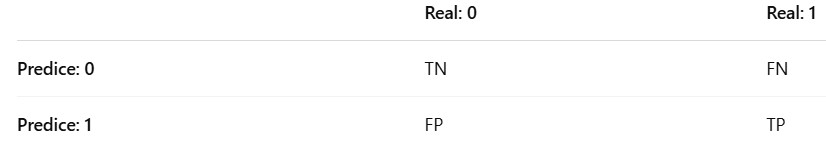

Cargamos librerías
```{r, message=FALSE, warning=FALSE}
library(readxl)
library(ggplot2)
library(ggpubr)
library(MVN)
library(car)
library(biotools) # test de Matriz de Covarianzas
library(MASS) #Para poder usar la función lda/qda
library(GGally) # Para el pairplot
library(caTools) # sample.split
library(dplyr)
library(caret) # Matriz de confusión
```

Cargamos la base de datos
```{r}
df_pacientes <- read_excel("Cáncer Próstata1.xlsx")
head(df_pacientes)
```

**Análisis Exploratorio**

Verificamos la presencia de missing values.
```{r}
colSums(is.na(df_pacientes)) # No hay presencia de missing values.
```

Verificamos la clase a la que pertenecen nuestras variables.
```{r}
str(df_pacientes) # Tenemos la variabla diagnóstico como tipo character.
df_pacientes$diagnostico <- factor(df_pacientes$diagnostico) # Convertimos a factor.
glimpse(df_pacientes)
```

Realizamos un pairplot.
```{r, warning=FALSE, message=FALSE}
ggpairs(data = df_pacientes, aes(color = diagnostico))
```

  - La variable PSA diferencia perfectamente el diagnóstico, mientras mayor sea será Positivo.
  
  - La variable edad no proporciona con certeza la diferencia entre las clases. Pudieramos pensar que entre mayor edad, el resultado será negativo. 
  
**Verificamos los supuestos del modelo**

Dividimos nuestros datos en "Entrenamiento" y "Prueba"
```{r}
set.seed(42)
barajeado <- slice_sample(df_pacientes, prop = 1)
split <- sample.split(barajeado$diagnostico, SplitRatio = 0.8) # Vector lógico 
pacientes_train <- subset(barajeado, split == TRUE)
pacientes_test <- subset(barajeado, split == FALSE)
```

Verificar la normalidad de los datos para cada variable en cada grupo.
```{r}
vars <- names(pacientes_train)[-3]  # Excluimos la columna "diagnostico"
sapply(vars, function(var) {
  tapply(pacientes_train[[var]], pacientes_train$diagnostico, function(x) {
    p <- shapiro.test(x)$p.value
    if (p > 0.05) {
      return(paste0("p = ", round(p, 4), " → Normal"))
    } else {
      return(paste0("p = ", round(p, 4), " → No normal"))
    }
  })
})
# No se viola gravemente el supuesto.
```

Verificamos la normalidad multivariada.

Paso previo: Identificamos la presencia de outliers con la prueba de Henze-Zirkler, para decidir el tipo de prueba de normalidad multivariada más adecuada.
```{r}
mvn(data = subset(pacientes_train, diagnostico == "Negativo")[,-3], mvnTest = "royston", multivariateOutlierMethod = "quan")
mvn(data = subset(pacientes_train, diagnostico == "Positivo")[,-3], mvnTest = "hz", multivariateOutlierMethod = "quan") # No viola gravemente el supuesto de normalidad multivariada.
```

  - No tenemos normalidad multivariada en los casos Negativos.
  
  - Sí tenemos normalidad multivariada en los casos Positivos.

**Homogeniedad de varianzas y la homogeniedad de matrices de covarianza**

Homogeniedad de varianzas:
  
  Hipótesis nula (H₀): Las varianzas son iguales en todos los grupos.
  Hipótesis alternativa (H₁): Las varianzas no son iguales en todos los grupos.
  
```{r}
leveneTest(Edad ~ diagnostico, data = pacientes_train) # La varianzas son iguales
leveneTest(PSA ~ diagnostico, data = pacientes_train) # Las varianzas son iguales
```

**Homogeniedad de matrices de covarianza**
   
   Ho: La matriz de covarianza es igual en todos los grupos.
   H1: La matriz de covarianza es diferente en todos los grupos.

Calculamos las matrices de covarianza
```{r}
pacientes_negativo <- subset(pacientes_train, diagnostico == "Negativo")
pacientes_positivo <- subset(pacientes_train, diagnostico == "Positivo")
cov(pacientes_negativo[,-3]); cov(pacientes_positivo[,-3])
```

Realizamos el test
```{r}
boxM(data = pacientes_train[,-3], grouping = pacientes_train$diagnostico) # Las matrices de covarianza no son iguales.
```

**Estimación de coeficientes para el modelo QDA**

```{r}
modelo_qda <- qda(diagnostico ~ ., data = pacientes_train)
modelo_qda$scaling
```

**Realizamos predicciones**

```{r}
predicciones <- predict(object = modelo_qda, newdata = pacientes_test)
predicciones$posterior # Probabilidades Posteriores.
clase_predicha <- predicciones$class # Clasificación.
```

**Generamos la matriz de Confusión**



```{r}
dato_real <- factor(pacientes_test$diagnostico, levels = levels(pacientes_test$diagnostico))
dato_predicho <- factor(clase_predicha, levels = levels(pacientes_test$diagnostico))

# Matriz de confusión y métricas
conf_matrix <- confusionMatrix(data = dato_predicho, reference = dato_real, positive = "Positivo")
print(conf_matrix$table)

# Métricas individuales
accuracy <- conf_matrix$overall["Accuracy"] # Proporción total de predicciones correctas.
precision <- conf_matrix$byClass["Precision"]
recall <- conf_matrix$byClass["Recall"]
f1 <- conf_matrix$byClass["F1"]

# Imprimir métricas
cat("Accuracy (Exactitud):", accuracy, "\n")
cat("Precision (Precisión):", precision, "\n")
cat("Recall (Sensibilidad):", recall, "\n")
cat("F1 Score:", f1, "\n")
```

  - Verdaderos negativos (TN = 35): El modelo clasificó correctamente a 35 pacientes como negativos para cáncer de próstata, y efectivamente no lo tienen.
  
  - Verdaderos positivos (TP = 4): El modelo clasificó correctamente a 4 pacientes como positivos para cáncer de próstata, y efectivamente lo tienen.
  
  - Falsos negativos (FN = 1): El modelo clasificó erróneamente a 1 paciente como negativo, cuando en realidad sí tiene cáncer de próstata.
  
  - Falsos positivos (FT = 0): El modelo no cometió errores clasificando a pacientes como positivos cuando en realidad no lo eran.
  
  - Exactitud (Accuracy = 97.5%): El modelo acertó en el 97.5% de los casos, tanto al identificar correctamente a los pacientes con cáncer de próstata como a quienes no lo tienen. Este es un rendimiento excelente, lo que indica que el modelo generaliza bien en este conjunto de datos.
  
  - Precisión (Precision = 100%): De todos los pacientes que el modelo clasificó como positivos para cáncer de próstata, el 100% realmente lo tenían. Esto indica que el modelo no genera falsos positivos.
  
  - Sensibilida (Recall = 80%): El modelo identificó correctamente al 80% de los pacientes que realmente tienen cáncer de próstata. Es decir, pasó por alto a un 20% de ellos, lo cual podría ser clínicamente importante dependiendo del contexto.
  
  - F1 Score = 88.89%: Un 88.89% indica un buen equilibrio entre no generar falsos positivos y no pasar por alto casos reales de cáncer de próstata.
